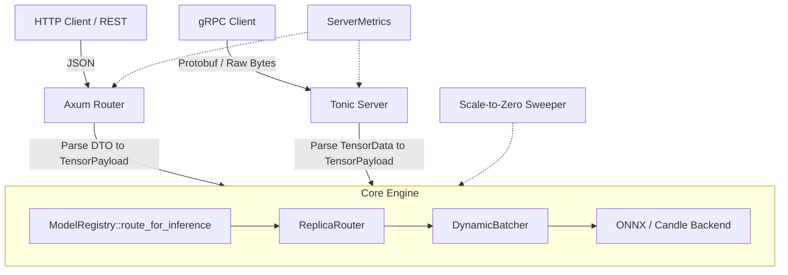

# SnoozeML gRPC Architecture & Communication Schema Specification

This document details the architectural design, Protobuf communication schemas, memory transport mechanics, and integration strategy for adding a high-performance gRPC interface to SnoozeML.

---

## 1. Motivation & Design Goals

While the existing HTTP/1.1 and HTTP/2 REST API (powered by Axum) provides ergonomic JSON access, high-throughput machine learning inference workloads encounter distinct bottlenecks with JSON:
1. **Serialization Overhead**: Serializing and parsing large float arrays (e.g. `[101.0, 2054.0, ...]`) as JSON strings creates massive CPU churn and memory allocations.
2. **Payload Bloat**: Text-encoded floats consume 3x to 6x more bandwidth than raw binary IEEE 754 representations.
3. **Lack of Multiplexed Binary Streaming**: Efficient client-side pipelining and token-level streaming require native binary frames over HTTP/2.

### Core Objectives
- **Zero-Copy / Minimal-Copy Ingestion**: Ingest raw byte buffers directly from gRPC frames into `ndarray` buffers without per-element parsing.
- **Defensive Design & Zero-Panic Safety**: Enforce strict length and alignment validation on raw buffers before constructing internal `TensorPayload` instances.
- **Unified Engine Integration**: Reuse the identical core inference pipeline (`ModelRegistry`, `ReplicaRouter`, `DynamicBatcher`) without duplicating execution logic.
- **Observable & Production-Ready**: Integrate standard `grpc.health.v1` probes, structured `tracing`, and shared Prometheus telemetry.

---

## 2. Schema Strategy: SnoozeML Native vs. Triton/KServe v2

### Selected Approach: SnoozeML-Native Schema (Phase 1)
We adopt a **tailored SnoozeML Protobuf schema** (`snoozeml.v1`). This minimizes protocol bloat, keeps message definitions direct and readable, and directly mirrors SnoozeML's internal primitives (dynamic batching, replica routing, model states, and scale-to-zero metadata).

### Future Roadmap: KServe v2 / Triton Compatibility Adapter (Phase 2+)
The [KServe v2 Data Plane standard](https://github.com/kserve/kserve/blob/master/docs/predict-api/v2/dataplane.md) (implemented by Triton Inference Server, TorchServe, and TF Serving) is widely adopted by enterprise tooling (`tritonclient` in Python/C++). 

Because Tonic allows registering multiple gRPC services on the same server, SnoozeML can later register the standard KServe v2 service (`inference.GRPCInferenceService`) alongside the SnoozeML-native service. Both services will simply adapt their respective DTOs into SnoozeML's internal `TensorPayload` and delegate to `ModelRegistry`.

---

## 3. Communication Schema (`proto/snoozeml/v1/inference.proto`)

```protobuf
syntax = "proto3";

package snoozeml.v1;

// ============================================================================
// Core Inference Service
// ============================================================================

service InferenceService {
  // Executes unary inference for a registered model.
  rpc Infer(ModelInferRequest) returns (ModelInferResponse);

  // Bi-directional streaming for pipelined request submission and token streaming.
  rpc StreamInfer(stream ModelInferRequest) returns (stream ModelInferResponse);
}

// Supported tensor element data types.
enum DataType {
  DATA_TYPE_UNSPECIFIED = 0;
  DATA_TYPE_FP32 = 1;
  DATA_TYPE_FP16 = 2;
  DATA_TYPE_BF16 = 3;
  DATA_TYPE_INT32 = 4;
  DATA_TYPE_INT64 = 5;
  DATA_TYPE_UINT8 = 6;
  DATA_TYPE_BOOL = 7;
}

// Represents a multi-dimensional tensor with raw binary memory buffer.
message TensorData {
  // Input or output node binding identifier (e.g. "input_ids", "logits").
  string name = 1;

  // Tensor dimensions (e.g. [1, 3, 224, 224]).
  repeated int64 shape = 2;

  // Primitive element data type.
  DataType data_type = 3;

  // Contiguous raw bytes in little-endian format (e.g. 4 bytes per float for FP32).
  // This enables zero-copy or single-memcpy memory mapping into engine arrays.
  bytes raw_data = 4;
}

message ModelInferRequest {
  // Unique identifier of the target model.
  string model_id = 1;

  // Ordered list of input tensors.
  repeated TensorData inputs = 2;

  // Optional client-specified request timeout in milliseconds.
  optional uint64 client_timeout_ms = 3;

  // Optional execution parameters or routing hints.
  map<string, string> parameters = 4;
}

message ModelInferResponse {
  // Identifier of the model that executed the request.
  string model_id = 1;

  // Resulting output tensors.
  repeated TensorData outputs = 2;

  // Execution latency in milliseconds (microsecond precision).
  double duration_ms = 3;
}

// ============================================================================
// Model Lifecycle & Registry Management Service
// ============================================================================

service ModelRegistryService {
  // Lists metadata and operational status for all registered models.
  rpc ListModels(ListModelsRequest) returns (ListModelsResponse);

  // Retrieves metadata and operational telemetry for a specific model.
  rpc GetModelMetadata(ModelMetadataRequest) returns (ModelMetadataResponse);

  // Forces loading model weights into memory (pre-warming).
  rpc LoadModel(ModelLoadRequest) returns (ModelLoadResponse);

  // Deallocates model weights to zero host/device memory.
  rpc UnloadModel(ModelUnloadRequest) returns (ModelUnloadResponse);
}

message ListModelsRequest {}

message ListModelsResponse {
  repeated ModelMetadataResponse models = 1;
}

message ModelMetadataRequest {
  string model_id = 1;
}

message ModelMetadataResponse {
  string id = 1;
  string state = 2;
  string path = 3;
  uint64 idle_timeout_secs = 4;
  uint64 max_batch_size = 5;
  uint64 max_batch_delay_ms = 6;
  uint64 last_accessed_secs_ago = 7;
  optional string description = 8;
}

message ModelLoadRequest {
  string model_id = 1;
}

message ModelLoadResponse {
  string model_id = 1;
  string status = 2;
}

message ModelUnloadRequest {
  string model_id = 1;
}

message ModelUnloadResponse {
  string model_id = 1;
  string status = 2;
}
```

---

## 4. High-Performance Tensor Transport & Rust Ingestion

### Why Avoid `repeated float`?
Protobuf `repeated float` forces the compiler to generate a `Vec<f32>`, parsing variable-length varints/fixed32 records one item at a time. For an embedding or vision model payload with millions of floats, this introduces significant latency and memory pressure.

### Raw Memory Layout (`bytes raw_data`)
By using `bytes raw_data`, the client transmits contiguous memory blocks:
- **FP32**: 4 bytes per float, little-endian IEEE 754.
- Total expected length: $\prod_{i} \text{shape}[i] \times \text{sizeof}(\text{DataType})$.

### Zero-Panic Rust Ingestion (`convert.rs`)
In accordance with our strict defensive programming standards, buffer conversion must handle invalid payloads gracefully without panics:

```
[ Client gRPC Frame ]
         │ (bytes::Bytes raw buffer)
         ▼
[ Step 1: Shape & Element Count Check ]
   - Validate dimension overflow: checked_mul(dim)
   - Validate byte length: raw_data.len() == total_elements * 4
         ▼
[ Step 2: Safe Memory Cast or Copy ]
   - If buffer is 4-byte aligned:
       bytemuck::cast_slice::<u8, f32>(&raw_data) (zero-copy slice)
   - If misaligned:
       Allocate aligned buffer and copy_from_slice
         ▼
[ Step 3: Construct ArrayD<f32> & TensorPayload ]
         ▼
[ DynamicBatcher Ingestion ]
```

On response serialization, `TensorPayload::into_components()` extracts the contiguous `Vec<f32>`, which is safely cast to `&[u8]` via `bytemuck::cast_slice` and wrapped in `bytes::Bytes` for gRPC wire transmission.

---

## 5. Integration Architecture

The gRPC server layer integrates directly alongside the existing Axum HTTP layer without duplicating business logic:



### Execution Flow
1. The gRPC handler extracts `model_id` and converts `TensorData` items into `Vec<TensorPayload>`.
2. Calls `state.registry.route_for_inference(&model_id).await`.
3. Dispatches inference via `controller.infer(inputs).await`.
4. Records execution telemetry via `state.metrics.record_inference(success, duration_us)`.
5. Converts results back to `ModelInferResponse` and returns `Ok(Response::new(resp))`.

---

## 6. Error Handling & gRPC Status Mapping

SnoozeML maps its internal domain [`InferenceError`](../src/types.rs) to canonical gRPC status codes:

| `InferenceError` Variant | gRPC Code | Notes / Metadata |
| :--- | :--- | :--- |
| `NotFound(msg)` | `Status::not_found` | Model identifier is not registered. |
| `InvalidInput(msg)` | `Status::invalid_argument` | Shape mismatch, dimension overflow, buffer length mismatch. |
| `ShapeMismatch(msg)` | `Status::invalid_argument` | Incompatible tensor shapes during micro-batch collation. |
| `Timeout` | `Status::deadline_exceeded` | Queuing or execution deadline expired. |
| `Loading` | `Status::unavailable` | Model weights are actively being loaded into memory. |
| `OutOfMemory(msg)` | `Status::resource_exhausted` | System host RAM or GPU VRAM allocation failure. |
| `ResourceExhausted(msg)` | `Status::resource_exhausted` | Attached `retry-after: 5` metadata. |
| `UnsupportedSafetensorsArchitecture(msg)` | `Status::unimplemented` | Model architecture not supported by native safetensors loader. |
| `Runtime(msg)` / `QueueError(msg)` | `Status::internal` | Engine execution or background channel failure. |

---

## 7. Operational Standards: Health & Telemetry

### Standard Health Checking (`grpc.health.v1`)
Rather than relying solely on custom health endpoints, SnoozeML will utilize the official `tonic-health` implementation:
- **`grpc.health.v1.Health/Check`**
- **`grpc.health.v1.Health/Watch`**

This allows out-of-the-box compatibility with:
- Kubernetes container probes (`grpc: { port: 50051 }`)
- Envoy, Traefik, and NGINX gRPC upstream health checks
- The standard `grpc-health-probe` diagnostic binary

### Structured Logging & Metrics
- Every gRPC method invocation traces structured parameters: `model_id`, `input_tensor_count`, `batch_size`, `duration_ms`.
- Standard Prometheus counters in `ServerMetrics` track gRPC call counts, errors, and latencies identically to HTTP requests.

---

## 8. Network & Port Topology

### Dedicated gRPC Port (Default)
In accordance with production serving conventions (such as Triton and TorchServe), SnoozeML will bind gRPC to a distinct port:
- **HTTP/REST Port**: `8080` (default)
- **gRPC Port**: `50051` (default)

This provides:
- Independent client keepalive and HTTP/2 connection pooling settings.
- Independent rate limiting and reverse proxy routing.
- Isolation of large streaming tensor buffers from standard REST endpoints.

---

## 9. File & Module Structure

When ready to implement, the codebase additions will be organized as follows:

```text
SnoozeML/
├── proto/
│   └── snoozeml/
│       └── v1/
│           └── inference.proto         # Protobuf definition
├── build.rs                            # tonic-build compile step
├── Cargo.toml                          # tonic, prost, tonic-health, bytemuck
└── src/
    ├── server/
    │   ├── mod.rs                      # Lifecycle coordinator (Axum + Tonic runners)
    │   ├── http.rs                     # Axum REST routes (existing)
    │   ├── grpc/                       # gRPC subsystem
    │   │   ├── mod.rs                  # Tonic server setup & port binding
    │   │   ├── service.rs              # Implements InferenceService & ModelRegistryService
    │   │   └── convert.rs              # Zero-panic DTO conversions & Status mapping
    │   └── metrics.rs                  # Shared Prometheus metrics
```
