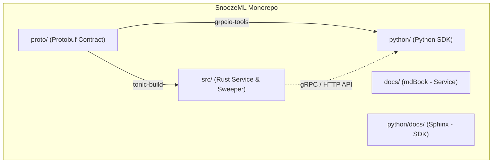
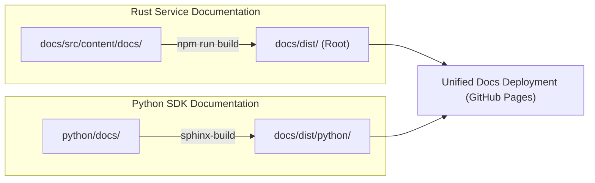

# SnoozeML Python SDK & Monorepo Architecture Specification

This document details the architectural design, repository structure, decoupled documentation strategy (Astro Starlight + Sphinx), client library capabilities, and CI/CD pipelines for integrating an official Python package alongside the SnoozeML Rust core service.

---

## 1. Executive Summary & Design Decision

SnoozeML operates as a high-performance model lifecycle manager and inference engine written in Rust. Machine learning engineers and data scientists, however, interface primarily via Python.

Rather than maintaining a separate repository, SnoozeML adopts a **monorepo structure** containing both the Rust core engine and the official `snoozeml` Python package.



### Why a Monorepo?
1. **Contract Synchronization & Zero Schema Drift**: gRPC (`.proto`) definitions and REST schemas reside in the same repository. Breaking API changes or schema extensions are committed, reviewed, and tested in a single atomic pull request.
2. **End-to-End Integration Testing**: CI pipelines compile the Rust service binary, launch the daemon in background test harness, and execute `pytest` suites against real gRPC/REST endpoints without multi-repo artifact coordination.
3. **Streamlined Maintenance**: Unified issue tracking, discussions, and release governance.

---

## 2. Repository Layout

The repository maintains strict separation between the Rust binary crate and the Python package:

```text
SnoozeML/
├── Cargo.toml                  # Rust workspace / crate definition
├── Cargo.lock
├── src/                        # SnoozeML Rust service source code
│   ├── main.rs
│   ├── engine.rs
│   ├── sweeper.rs
│   └── ...
├── proto/                      # Shared gRPC & Protobuf schemas
│   └── snoozeml/
│       └── v1/
│           ├── inference.proto
│           └── management.proto
├── docs/                       # Astro Starlight documentation portal (Service docs)
│   ├── astro.config.mjs        # Astro Starlight configuration
│   ├── package.json            # Node.js dependencies
│   └── src/content/docs/       # Markdown source files for guides & reference
├── python/                     # Python SDK root directory
│   ├── pyproject.toml          # Package metadata, dependencies, build config
│   ├── README.md               # PyPI README & quickstart
│   ├── snoozeml/               # Python source tree
│   │   ├── __init__.py
│   │   ├── client.py           # Sync & Async high-level client
│   │   ├── exceptions.py       # SnoozeML domain exceptions
│   │   ├── models.py           # Model lifecycle & state management
│   │   ├── inference.py        # Raw gRPC & REST tensor inference
│   │   ├── converters/         # Optional ONNX export utilities
│   │   │   ├── __init__.py
│   │   │   ├── sklearn.py      # scikit-learn pipeline converter
│   │   │   └── torch.py        # PyTorch model converter
│   │   └── _proto/             # Generated gRPC stubs (internal)
│   ├── docs/                   # Sphinx documentation source
│   │   ├── conf.py             # Sphinx configuration
│   │   ├── index.rst
│   │   ├── api/
│   │   └── Makefile
│   └── tests/                  # Pytest unit & integration tests
│       ├── test_client.py
│       ├── test_converters.py
│       └── test_integration_e2e.py
└── .github/
    └── workflows/
        ├── rust-ci.yml         # Rust tests, clippy, formatting
        ├── python-ci.yml       # Python linting, typing, pytest
        └── docs.yml            # Unified doc build & deployment
```

---

## 3. Decoupled Documentation Architecture (Astro Starlight + Sphinx)

Because SnoozeML serves two distinct personas—systems/DevOps engineers deploying the daemon, and data scientists using the Python SDK—documentation is divided into two specialized documentation generators.



### 3.1. Service Documentation: Astro Starlight
- **Target Audience**: Infrastructure operators, backend engineers, and systems developers.
- **Engine**: [Astro Starlight](https://starlight.astro.build/).
- **Scope**:
  - Architecture, concurrency model, and thread pools.
  - Resource sweeper, eviction policies, and memory accounting.
  - gRPC protocol specification and zero-copy tensor transport.
  - Configuration flags, environment variables, and Docker/Kubernetes deployment.
- **Location**: `docs/` with content collections under `docs/src/content/docs/`.
- **Output Destination**: Root of the documentation site (`/`).

### 3.2. Python SDK Documentation: Sphinx
- **Target Audience**: Data scientists, ML engineers, and application developers.
- **Engine**: [Sphinx](https://www.sphinx-doc.org/) with `shibuya` theme and autodoc.
- **Scope**:
  - Python installation, quickstart guides, and usage examples.
  - Complete API reference generated automatically from docstrings and Python 3.10+ type hints (`snoozeml.Client`, `snoozeml.models.ModelInfo`, etc.).
  - Step-by-step guides for scikit-learn, PyTorch, and XGBoost automatic ONNX conversion.
- **Location**: `python/docs/`.
- **Output Destination**: Hosted under `/python/` subpath.

### 3.3. Cross-Linking & Navigation Strategy
- The Starlight sidebar includes an external link: **"Python SDK API Reference (Sphinx) ↗"** pointing to `/SnoozeML/python/`.
- The Sphinx theme includes a top navigation bar link: **"← Back to SnoozeML Main Docs"** pointing to `../`.
- Both generators build independently during local development:
  - Rust/Service: `npm --prefix docs run dev`
  - Python SDK: `sphinx-build -b html python/docs docs/dist/python`

---

## 4. Python Package Specification (`snoozeml`)

### 4.1. Packaging & Dependency Management
The package uses standard PEP 621 metadata via `pyproject.toml` (using `flit_core`, `hatchling`, or `poetry-core`).

To keep the runtime lightweight, heavy ML frameworks are defined as **optional extras**:

```toml
[project]
name = "snoozeml"
version = "0.1.0"
description = "Official Python client and ML tooling for SnoozeML"
readme = "README.md"
requires-python = ">=3.9"
dependencies = [
    "httpx>=0.27.0",       # Async/sync REST transport
    "grpcio>=1.62.0",      # gRPC client
    "protobuf>=4.25.0",    # Protobuf serialization
    "numpy>=1.24.0",       # Tensor array handling
    "pydantic>=2.6.0",     # Schema validation and settings
]

[project.optional-dependencies]
# Optional automatic ONNX conversion dependencies
converters = [
    "onnx>=1.15.0",
    "skl2onnx>=1.16.0",
    "torch>=2.0.0",
]
# Development dependencies
dev = [
    "pytest>=8.0.0",
    "pytest-asyncio>=0.23.0",
    "mypy>=1.9.0",
    "ruff>=0.3.0",
    "sphinx>=7.2.0",
    "sphinx-rtd-theme>=2.0.0",
]
```

### 4.2. Core Functionality & API Design

#### A. Model Management & Lifecycle Control
Allows users to dynamically query states, pin models in memory, or trigger evictions:

```python
from snoozeml import SnoozeClient

client = SnoozeClient(endpoint="localhost:50051")

# List all loaded and registered models
models = client.models.list()

# Inspect specific model state and last accessed timestamp
info = client.models.get("bert-base-uncased")
print(f"Status: {info.state}, Memory: {info.memory_bytes / 1024 / 1024:.2f} MB")

# Pin model in memory (prevents sweeper from unloading/snoozing)
client.models.pin("bert-base-uncased")

# Explicit eviction / snooze
client.models.evict("bert-base-uncased")
```

#### B. Inference (Unary & Streaming)
Supports both REST (JSON/ndarray) and high-throughput gRPC with raw tensor byte transport:

```python
import numpy as np
from snoozeml import SnoozeClient

client = SnoozeClient(endpoint="localhost:50051", use_grpc=True)

# Generate sample tensor
input_data = np.random.randn(1, 128).astype(np.float32)

# Unary raw tensor inference
response = client.infer(
    model_id="bert-base-uncased",
    inputs={"input_ids": input_data}
)
output = response.get_numpy("logits")
```

#### C. Built-in ONNX Conversion (`snoozeml.converters`)
Implements seamless conversion pipelines so users can export scikit-learn or PyTorch models directly into SnoozeML without manually managing ONNX opsets or export scripts:

```python
from snoozeml.converters import export_sklearn, export_torch

# 1. Scikit-learn Pipeline Conversion
from sklearn.ensemble import RandomForestClassifier
clf = RandomForestClassifier().fit(X_train, y_train)

onnx_path = export_sklearn(
    model=clf,
    initial_types=[("float_input", (None, 4))],
    output_path="models/rf_classifier.onnx"
)

# 2. PyTorch Model Conversion
import torch
import torchvision.models as models
resnet = models.resnet18(pretrained=True).eval()

dummy_input = torch.randn(1, 3, 224, 224)
onnx_path = export_torch(
    model=resnet,
    sample_input=dummy_input,
    dynamic_axes={"input": {0: "batch_size"}, "output": {0: "batch_size"}},
    output_path="models/resnet18.onnx"
)
```

---

## 5. CI/CD & Release Strategy

### 5.1. Selective CI Triggering (Path Filtering)
To ensure rapid CI turnaround, changes in `python/**` do not trigger long Rust builds, and vice-versa.

- **`rust-ci.yml`**:
  ```yaml
  on:
    push:
      paths:
        - "src/**"
        - "tests/**"
        - "Cargo.*"
        - "proto/**"
  ```
- **`python-ci.yml`**:
  ```yaml
  on:
    push:
      paths:
        - "python/**"
        - "proto/**"
  ```

### 5.2. End-to-End Integration Job
A dedicated scheduled or pull-request job builds the Rust service binary and runs the Python test suite against the live binary:

```yaml
jobs:
  e2e-test:
    runs-on: ubuntu-latest
    steps:
      - uses: actions/checkout@v4
      - uses: dtolnay/rust-toolchain@stable
      - run: cargo build --release
      - name: Start SnoozeML daemon
        run: ./target/release/snoozeml --config tests/fixtures/config.toml &
      - name: Run Python E2E tests
        working-directory: python
        run: |
          pip install -e ".[dev]"
          pytest tests/test_integration_e2e.py
```

### 5.3. Documentation Build & Deployment Workflow (`docs.yml`)
When changes occur on the `main` branch under `docs/**` or `python/docs/**`:

```yaml
jobs:
  deploy-docs:
    runs-on: ubuntu-latest
    steps:
      - uses: actions/checkout@v4
      - name: Setup Node.js & Starlight
        uses: actions/setup-node@v4
        with:
          node-version: "20"
      - name: Build Service Docs (Starlight)
        working-directory: docs
        run: |
          npm ci
          npm run build
      - name: Set up Python & Sphinx
        uses: actions/setup-python@v5
        with:
          python-version: "3.12"
      - name: Build Python SDK Docs (Sphinx)
        run: |
          pip install -e "python[full,dev]"
          sphinx-build -b html python/docs docs/dist/python
      - name: Deploy to GitHub Pages
        uses: actions/deploy-pages@v4
```

---

## 6. Implementation Roadmap

1. **Phase 1 (Monorepo Scaffolding & Shared Protos)**:
   - Create `python/` directory with `pyproject.toml` and packaging scaffolding.
   - Establish `proto/` directory and configure code-generation in both Rust (`build.rs` via `tonic-build`) and Python (`grpcio-tools`).
2. **Phase 2 (Documentation Setup)**:
   - Configure Astro Starlight in `docs/` covering core service docs.
   - Initialize `python/docs/` with Sphinx configuration, Shibuya theme, and docstring autodoc.
   - Set up unified GitHub Actions deployment targeting `/` and `/python/`.
3. **Phase 3 (Core Python Client)**:
   - Implement `SnoozeClient` supporting model listing, state inspection, pinning, unpinning, and eviction.
   - Implement unary inference client over gRPC with numpy serialization.
4. **Phase 4 (Converters & Advanced Features)**:
   - Implement `snoozeml.converters.sklearn` and `snoozeml.converters.torch`.
   - Add bi-directional streaming inference support.
