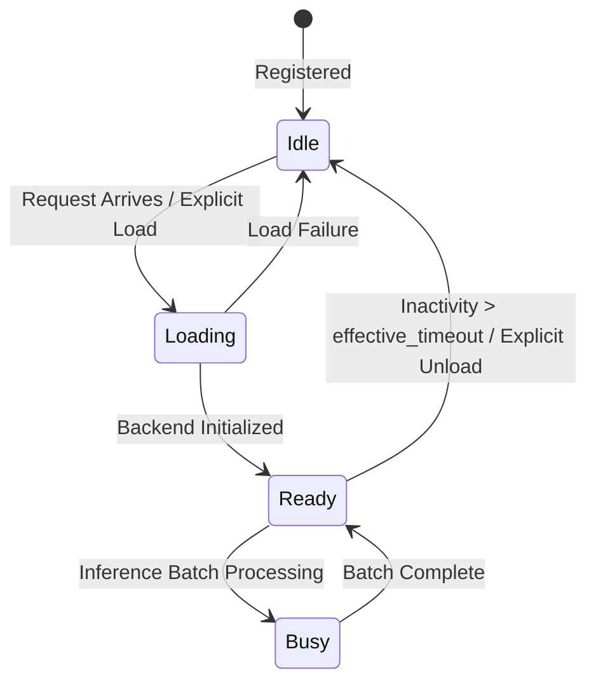

# SnoozeML Inference Daemon: Architectural Overview

## 1. System Philosophy & Objectives

SnoozeML is a high-performance, single-binary, bare-metal inference daemon designed for deep learning models across modalities (Computer Vision, Tabular, Embeddings, Audio, NLP/Transformers). 

Primary architectural goals:
- **Zero Idle Resource Consumption (Scale-to-Zero)**: Deallocate weights from GPU VRAM and host RAM when inactive, while preserving seamless lazy rehydration for subsequent requests.
- **Dynamic Micro-Batching**: Transparently collate independent asynchronous client requests into batched tensors along `Axis(0)` to saturate hardware accelerators without client-side coordination.
- **Zero-Panic Defensive Engineering**: Eliminate runtime panics in production through compile-time bounds checking, checked arithmetic, and resilient error bubbling via `thiserror`.
- **Extensibility**: Provide modular backend interfaces (`ModelBackend`) supporting ONNX Runtime (`ort`), Safetensors/Candle, and deterministic testing engines.

---

## 2. Component Diagram & Request Flow

```text
       ┌────────────────────────────────────────────────────────┐
       │                   Client Interfaces                    │
       │           HTTP/REST (Axum)  │  IPC (UDS / SHM)         │
       └───────────────────────────┬────────────────────────────┘
                                   │
                                   ▼
       ┌────────────────────────────────────────────────────────┐
       │                    Model Registry                      │
       │     Arc<RwLock<HashMap<String, Arc<ModelReplicaGroup>>>>│
       │  - Model lookup, global admission & dynamic scaling    │
       │  - Resource supervisor & reactive OOM eviction         │
       └───────────────────────────┬────────────────────────────┘
                                   │
                                   ▼
       ┌────────────────────────────────────────────────────────┐
       │           Model Replica Group & Router                 │
       │   - Autoscale trigger: queue_backlog > threshold       │
       │   - ReplicaRouter: Least-Queue / Round-Robin / Random  │
       └─────────────┬────────────────────────────┬─────────────┘
                     │                            │
                     ▼ Replica 0 (Primary)        ▼ Replica 1..N (Auto-scaled)
       ┌───────────────────────────┐┌───────────────────────────┐
       │   Model Controller #0     ││   Model Controller #N     │
       │ - Idle timeout: T_base    ││ - Idle timeout: T_base / N│
       │ - Dynamic Batch Accumulator││ - Dynamic Batch Accumulator│
       └─────────────┬─────────────┘└─────────────┬─────────────┘
                     │                            │
                     ▼                            ▼
       ┌────────────────────────────────────────────────────────┐
       │           Execution Engine (Rayon / Worker)            │
       │  - ModelBackend::infer(&batched_inputs)                │
       │  - Un-slicing batched outputs along Axis(0)            │
       └───────────────────────────┬────────────────────────────┘
                                   │ Sliced Responses
                                   ▼
       ┌────────────────────────────────────────────────────────┐
       │     tokio::sync::oneshot::Sender<InferenceResponse>    │
       │     Dispatches individual tensor slices to clients     │
       └────────────────────────────────────────────────────────┘
```

---

## 3. Dynamic Batching Algorithm

The dynamic micro-batch accumulator operates on a dual-trigger mechanism:
1. **Capacity Threshold**: If aggregate batch volume reaches `max_batch_size`, the batch is immediately dispatched to the execution worker.
2. **Latency Budget**: If the queue is non-empty, a timer (`tokio::time::sleep_until(deadline)`) bounds the maximum waiting duration to `max_delay`.

### Leading Axis Collation
Given $N$ client requests where request $i$ presents an input tensor of shape $[B_i, C, H, W]$:
- The accumulator verifies that trailing dimensions $[C, H, W]$ match across all requests in the batch.
- Tensors are concatenated along leading dimension `Axis(0)` into a combined tensor of shape $[\sum B_i, C, H, W]$.
- After model execution returns outputs of shape $[\sum B_i, \dots]$, the accumulator slices the results along `Axis(0)` by the original offset and length $[B_i]$, routing each slice to the corresponding client's `oneshot` channel.

---

## 4. Scale-to-Zero State Machine



- **Idle**: Model configuration and routing metadata are active; no weights reside in RAM or GPU VRAM.
- **Loading**: Weights are actively streaming into device memory via `Session::commit_from_file`.
- **Ready**: Model is memory-resident and receptive to inference jobs.
- **Busy**: Execution worker is executing forward pass kernels.
- **Sweeper Task**: An asynchronous background task periodically inspects registered models and triggers `sweep_scale_to_zero()` to reclaim memory.

---

## 5. Horizontal Autoscaling & Differential Scale-to-Zero

### 5.1 Dynamic Replica Scaling Under Queue Saturation
When inference requests arrive for a model:
1. The model group inspects the queue backlog of its existing replicas.
2. If the minimum queue backlog exceeds `autoscale_queue_threshold` and the current replica count has not hit `max_replicas`:
   - **Replica Ceiling**: By default, `max_replicas` is **unbounded** (`None` or `0`), allowing the model to autoscale dynamically until hardware resources or the global `max_loaded_models` limit are reached.
   - **Global Capacity Check**: The supervisor checks overall capacity (`count_loaded_models() < max_loaded_models`).
   - **Reactive OOM Handling**: If capacity permits, a new `ModelController` replica is allocated and added to the replica group. If backend initialization encounters an Out-Of-Memory (OOM) error, the supervisor reactively purges an idle LRU candidate from memory before retrying. If memory remains exhausted, it gracefully falls back to routing to the least-queued existing replica.
3. The request is dispatched to the chosen replica.

### 5.2 Differential Scale-to-Zero Formula
To prevent resource waste while maintaining readiness:
- **Primary Instance ($k = 0$)**: Adheres strictly to the user-configured `idle_timeout` ($T_{\text{base}}$). It remains resident as long as requests arrive within that window.
- **Additional Replicas ($k \ge 1$)**: Deallocate more aggressively as a function of the total number of currently loaded instances $N$:

$$T_{\text{effective}}(k) = \begin{cases} T_{\text{base}} & \text{if } k = 0 \\ \max\left(\frac{T_{\text{base}}}{N}, 1\text{ms}\right) & \text{if } k \ge 1 \end{cases}$$

The more replicas exist concurrently, the faster excess idle copies are pruned back to baseline once load subsides.

### 5.3 Pluggable Routing Mechanism Among Replicas
Routing among identical replicas is abstracted through the `RoutingStrategy` trait:
- **Least-Queue Routing (`least-queue`, Default)**:
  Compares `(queue_len(), active_requests())` across loaded replicas and picks the replica with the smallest backlog.
- **Round-Robin Routing (`round-robin`)**:
  Atomically cycles requests evenly across all loaded replicas.
- **Random Routing (`random`)**:
  Distributes requests uniformly at random.
- **Extensibility**:
  Designed to support future strategies such as EWMA latency tracking, cache locality, and heterogeneous accelerator affinity.

---

## 6. Execution Backends & Runtimes

All model execution providers implement the unified `ModelBackend` trait:

```rust
pub trait ModelBackend: Send + Sync {
    fn infer(&self, inputs: &[TensorPayload]) -> Result<Vec<TensorPayload>, InferenceError>;
    fn provider_name(&self) -> &'static str;
}
```

### Supported Runtime Backends:
1. **ONNX Runtime (`OrtBackend`, feature: `ort-backend`)**:
   - Executes `.onnx` models with hardware acceleration via OpenMP, CUDA, or TensorRT.
   - Built on `ort` 2.0 with zero-copy ndarray bridging.
2. **Candle & Safetensors (`CandleBackend`, feature: `candle-backend`)**:
   - Executes `.safetensors` model weights with pure Rust or CUDA compute kernels via Hugging Face Candle.
   - Automatically chains linear projections and activations (ReLU, GELU, Identity).
   - Supports optional companion JSON architecture specifications (`{model}.json`).

