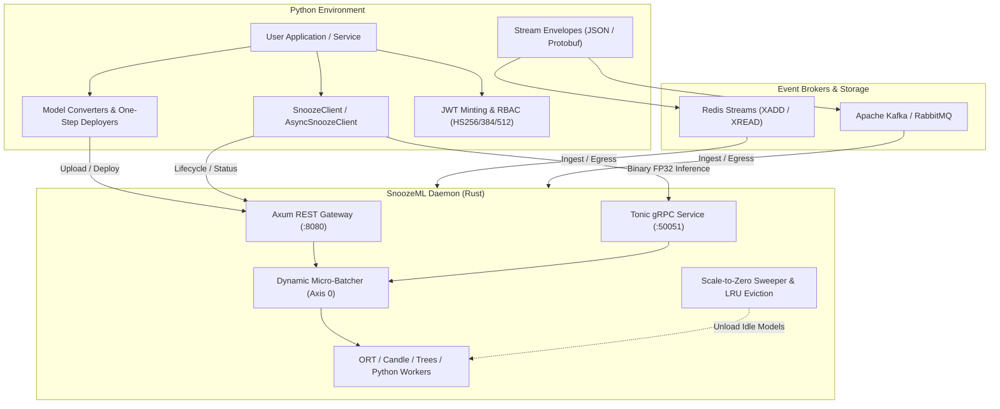
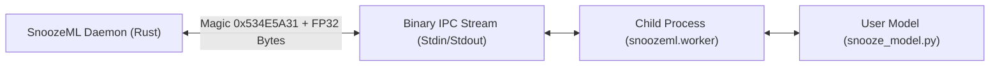

The official **SnoozeML Python SDK** (`snoozeml`, located under `python/`) provides a high-performance, developer-friendly interface to the SnoozeML inference daemon. It bridges machine learning workflows (PyTorch, scikit-learn, XGBoost, Hugging Face) with SnoozeML's scale-to-zero memory reclamation, dynamic micro-batching, and dual HTTP/gRPC transports.



---

## Capabilities Overview

| Module | Core Classes & Functions | Purpose |
| :--- | :--- | :--- |
| [`snoozeml.client`](#2-client-initialization--transports) | `SnoozeClient`, `AsyncSnoozeClient` | Synchronous and asynchronous inference over HTTP and gRPC with auto-retry and connection pooling. |
| [`snoozeml.models`](#5-model-lifecycle--memory-management) | `ModelsManager`, `ModelInfo`, `ModelState` | Query live memory state, pin/unpin models, trigger manual evictions, and wait for readiness. |
| [`snoozeml.models` (Deploy)](#6-one-step-model-deployment--framework-helpers) | `deploy_sklearn`, `deploy_torch`, `deploy_xgboost` | Export models in-memory, upload via multipart HTTP, and register on the daemon in a single call. |
| [`snoozeml.inference`](#3-tensor-inference--formats) | `InferenceResponse`, `TensorOutput`, `slice_inputs_batch` | NumPy and PyTorch tensor serialization, Axis(0) dataset slicing, and response concatenation. |
| [`snoozeml.converters`](#7-standalone-model-converters) | `export_sklearn`, `export_torch`, `export_xgboost` | Standalone export to dynamic ONNX or pure-Rust `.xgb.json` tree files on disk. |
| [`snoozeml.auth`](#11-security--jwt-minting) | `create_jwt_token`, `decode_jwt_token`, `Role` | RFC 7519 HMAC JWT minting and decoding with 3-tier RBAC (`ReadOnly`, `Inference`, `Admin`). |
| [`snoozeml.streams`](#10-event-streaming-pipelines) | `MockStreamClient`, `RedisStreamClient`, `StreamInferRequest` | Real-time event streaming envelopes, Redis Streams producer/consumer, and pipeline testing. |
| [`snoozeml.config`](#9-programmatic-configuration--local-daemon) | `SnoozeConfig`, `SnoozeDaemon`, `scaffold_worker` | Programmatic `models.toml` generation, local daemon test runner, and custom worker scaffolding. |
| [`snoozeml.metrics`](#12-telemetry--prometheus-metrics) | `parse_prometheus_metrics`, `DaemonMetrics` | Parse Prometheus exposition counters from `GET /metrics` for latency and cache monitoring. |
| [`snoozeml.logging`](#13-structured-logging--credential-redaction) | `configure_logging`, `RedactingFilter` | Structured key-value / JSON logging with automatic redaction of API keys and bearer tokens. |

---

## 1. Installation & Environment Setup

Install the official `snoozeml` package directly from PyPI:

```bash
# Core lightweight HTTP REST client (zero compiled C-extensions)
pip install snoozeml

# High-performance native gRPC transport + NumPy array support
pip install "snoozeml[grpc]"

# Model conversion toolkit (Scikit-Learn, ONNX, and XGBoost)
pip install "snoozeml[converters]"

# Complete toolkit (client, gRPC, custom worker, and all converters)
pip install "snoozeml[full]"
```

### Dependency Profiles & Extras

SnoozeML provides modular optional dependencies (extras) so your client applications and container images remain lean and avoid bloated dependencies:

| Extra | Command | Included Packages | Purpose & Technical Details |
| :--- | :--- | :--- | :--- |
| **Base** | `pip install snoozeml` | `requests>=2.28.0` | Ultra-lightweight HTTP REST client for model lifecycle management (`load`, `unload`, `pin`, `unpin`), status polling, health probes, Prometheus metrics, and basic inference. Pure Python with zero compiled binary dependencies or C-extensions. |
| **`[grpc]`** | `pip install "snoozeml[grpc]"` | `grpcio`, `grpcio-health-checking`, `protobuf`, `numpy` | High-throughput, low-latency binary gRPC transport with compiled protobuf stubs, health checking, and automatic NumPy `ndarray` marshaling to raw little-endian bytes. |
| **`[converters]`** | `pip install "snoozeml[converters]"` | `numpy`, `scikit-learn`, `onnx`, `skl2onnx`, `xgboost[-cpu]` | Complete offline model conversion toolkit (`export_sklearn`, `export_xgboost`, `deploy_sklearn`, `deploy_xgboost`). Bundles both `[onnx]` and `[xgboost]` extras. |
| **`[full]`** | `pip install "snoozeml[full]"` | `grpcio`, `protobuf`, `numpy`, `scikit-learn`, `onnx`, `skl2onnx`, `xgboost[-cpu]` | All-in-one distribution bundle combining `[grpc]`, `[worker]`, and `[converters]` with zero GPU/CUDA bloat. |
| **`[onnx]`** | `pip install "snoozeml[onnx]"` | `numpy`, `scikit-learn`, `onnx`, `skl2onnx` | Scikit-learn estimator and pipeline export (`export_sklearn`, `deploy_sklearn`) to ONNX runtime format. |
| **`[xgboost]`** | `pip install "snoozeml[xgboost]"` | `numpy`, `xgboost-cpu` (Linux) / `xgboost` (macOS/Win) | XGBoost model export to `.xgb.json` for pure-Rust `hessboost` tree execution. Dynamically resolves to `xgboost-cpu` on Linux via PEP 508 environment markers to prevent dragging heavy `nvidia-nccl` / CUDA packages into CPU environments. |
| **`[torch]`** | `pip install "snoozeml[torch]"` | `torch>=2.0.0` | PyTorch `nn.Module` export to ONNX (`export_torch`, `deploy_torch`). *Note: If PyTorch is already present in your environment, `snoozeml` automatically duck-types PyTorch tensors without requiring this extra.* |
| **`[worker]`** | `pip install "snoozeml[worker]"` | `numpy>=1.24.0` | Minimal runtime dependency profile for process-isolated custom Python worker models (`snooze_model.py`) using NumPy tensor format. |
| **`[dev]`** | `pip install "snoozeml[dev]"` | `pytest`, `pytest-asyncio`, `mypy`, `ruff`, `sphinx`, `shibuya` | Testing, linting, type validation, and Sphinx documentation build tooling. |

> [!NOTE]
> For editable local development or contributing from a local repository clone:
> ```bash
> pip install -e "./python[full,dev]"
> ```

---

## Quickstart: 60 Seconds to Inference

Here is a minimal, complete script that connects to a running SnoozeML instance, checks model status, runs inference, and retrieves predictions:

```python
import numpy as np
from snoozeml import SnoozeClient

# 1. Connect to local SnoozeML daemon (HTTP port 8080, gRPC port 50051)
with SnoozeClient(http_endpoint="http://localhost:8080", grpc_endpoint="localhost:50051", use_grpc=True) as client:
    
    # 2. Inspect registered models
    for model in client.models.list():
        print(f"Model {model.id} is currently {model.state.value} (loaded={model.is_loaded}, pinned={model.pinned})")
    
    # 3. Run inference with a NumPy array
    # Inputs can be a dictionary mapping input names to arrays, or a single array
    sample_inputs = {"input": np.random.randn(2, 4).astype(np.float32)}
    response = client.infer("iris_classifier", inputs=sample_inputs)
    
    # 4. Read outputs as NumPy arrays or PyTorch tensors
    predictions = response.get_numpy("output")
    print(f"Predictions shape: {predictions.shape}")
    print(f"Server latency: {response.duration_ms:.2f} ms")
```

---

## 2. Client Initialization & Transports

SnoozeML provides both synchronous (`SnoozeClient`) and asynchronous (`AsyncSnoozeClient`) clients. Both support HTTP REST and native gRPC transports.

```python
from snoozeml import SnoozeClient, AsyncSnoozeClient

# Synchronous client with gRPC enabled for inference and HTTP for lifecycle operations
client = SnoozeClient(
    http_endpoint="http://localhost:8080",
    grpc_endpoint="localhost:50051",
    use_grpc=True,               # Use gRPC for infer() forward passes
    api_key="sk-admin-key",      # Authentication (sent as x-api-key / Bearer)
    token=None,                  # Optional JWT Bearer token
    timeout=30.0,                # Request timeout in seconds
    max_retries=3,               # Automatic retries on transient 503 / Loading states
    retry_backoff=0.25,          # Initial backoff delay in seconds
)
```

### Transport Comparison

| Characteristic | HTTP REST (`use_grpc=False`) | Native gRPC (`use_grpc=True`) |
| :--- | :--- | :--- |
| **Default Port** | `8080` | `50051` |
| **Payload Wire Format** | Text JSON (`{"name": "x", "data": [1.0, 2.0]}`) | Binary Protocol Buffers (`snoozeml.v1.InferenceService`) |
| **Tensor Encoding** | Decimal ASCII float serialization | Direct IEEE-754 little-endian `FP32` raw byte buffers |
| **Serialization Overhead**| High (CPU string parsing, formatting) | Near-zero (direct `memcpy` via `arr.tobytes()`) |
| **Multiplexing** | HTTP/1.1 or HTTP/2 keep-alive | Multiplexed HTTP/2 streams |
| **Best Used For** | Web frontends, debugging, lifecycle controls | High-throughput batch inference, vision, embeddings |

> [!TIP]
> You can pass `use_grpc=True` globally on the client, or override it on individual inference calls: `client.infer("model_id", inputs, use_grpc=False)`. Lifecycle methods (`client.models.*`, `client.upload_model`) always use HTTP REST.

### Asynchronous Client (`AsyncSnoozeClient`)

For high-concurrency event loops, web frameworks (FastAPI, Quart), or concurrent micro-batching:

```python
import asyncio
import numpy as np
from snoozeml import AsyncSnoozeClient

async def run_concurrent_requests():
    async with AsyncSnoozeClient("http://localhost:8080", grpc_endpoint="localhost:50051", use_grpc=True) as client:
        # Launch 10 concurrent inference requests
        # SnoozeML's dynamic batcher will coalesce these into a single Axis(0) forward pass!
        tasks = [
            client.infer("demo-model", {"input": np.random.randn(1, 10).astype(np.float32)})
            for _ in range(10)
        ]
        responses = await asyncio.gather(*tasks)
        print(f"Processed {len(responses)} requests concurrently.")

asyncio.run(run_concurrent_requests())
```

---

## 3. Tensor Inference & Formats

The `infer()` method accepts diverse input types and returns an `InferenceResponse` object that makes extracting results painless.

### Supported Input Formats

You can pass inputs as a dictionary mapping tensor names to data, or as a single tensor if the model has only one input:

```python
import numpy as np
import torch
from snoozeml import SnoozeClient

client = SnoozeClient("http://localhost:8080")

# 1. NumPy arrays (must be convertible to float32)
resp = client.infer("model_a", {"input": np.zeros((1, 8), dtype=np.float32)})

# 2. PyTorch tensors (auto-detached from autograd and moved to CPU)
tensor = torch.randn(2, 8, requires_grad=True, device="cpu")
resp = client.infer("model_a", {"input": tensor})

# 3. Python native nested lists (no numpy required)
resp = client.infer("model_a", {"input": [[1.0, 2.0, 3.0, 4.0, 5.0, 6.0, 7.0, 8.0]]})

# 4. Single unnamed tensor (automatically mapped to the model's default input)
resp = client.infer("model_a", np.ones((1, 8), dtype=np.float32))
```

### Reading Output Tensors

`InferenceResponse` provides ergonomic helper methods for all common scientific Python formats:

```python
response = client.infer("model_a", {"input": np.ones((1, 8), dtype=np.float32)})

# Get primary output as NumPy ndarray (defaults to the first output if name omitted)
arr = response.get_numpy("output")
print(f"Shape: {arr.shape}, Dtype: {arr.dtype}")

# Convert directly to a PyTorch tensor on a designated device
torch_tensor = response.get_torch("output", device="cuda:0" if torch.cuda.is_available() else "cpu")
print(f"PyTorch device: {torch_tensor.device}")

# Convert to flat Python float list
flat_values = response.get_flat_list("output")

# Inspect raw execution duration measured on the server
print(f"Daemon forward latency: {response.duration_ms:.2f} ms")
```

---

## 4. Dataset Batch Chunking (`infer_dataset`)

When scoring large offline datasets or processing bulk feature sets (e.g., 50,000 rows), sending the entire batch in a single HTTP request can trigger payload limits, network timeouts, or out-of-memory errors on GPU backends. Conversely, sending rows one-by-one incurs severe network latency.

The `infer_dataset()` method automatically chunks your inputs along `Axis(0)` into optimal batch sizes, dispatches requests sequentially, and concatenates all responses into a single seamless `InferenceResponse`:

```python
import numpy as np
from snoozeml import SnoozeClient

client = SnoozeClient("http://localhost:8080", max_retries=3)

# A large dataset of 5,000 samples with 16 features
dataset = {
    "features": np.random.randn(5000, 16).astype(np.float32)
}

# Automatically chunk into batches of 128 along Axis(0) and concatenate results
response = client.infer_dataset(
    model_id="risk_model",
    inputs=dataset,
    batch_size=128,
    use_grpc=True,
)

# Output shape matches the full 5,000 samples!
final_predictions = response.get_numpy("probabilities")
print(f"Aggregated output shape: {final_predictions.shape}")  # (5000, 2)
```

> [!NOTE]
> `infer_dataset()` handles multiple input bindings simultaneously, slicing every tensor in `inputs` along `Axis(0)` proportionally.

---

## 5. Scale-to-Zero Resilience & Automatic Retries

SnoozeML's signature architectural feature is **Scale-to-Zero Memory Reclamation**. Idle models are automatically evicted from GPU VRAM or host RAM after a configurable timeout (`idle_timeout_secs`).

### The Scale-to-Zero Lifecycle

```
[Request Arrives] 
      │
      ├──> Model Ready in RAM/VRAM ──> Instant Forward Pass
      │
      └──> Model Idle (Unloaded) ──> State: Loading ──> 503 (Retry-After: 5)
                                          │
                                   [Weights Loaded]
                                          │
                                          └──> Ready for Traffic
```

When an inference request hits an unloaded model, SnoozeML triggers asynchronous weight loading and responds with HTTP status `503 Service Unavailable` (`InferenceError::Loading`) accompanied by a `Retry-After: 5` header. Similarly, if GPU memory is saturated, an LRU deallocation occurs (`ResourceExhausted`).

### Built-in Exponential Retry Engine

The Python SDK handles transient loading states transparently:

```python
from snoozeml import SnoozeClient

# Initialize client with automatic retry capabilities
client = SnoozeClient(
    "http://localhost:8080",
    max_retries=4,        # Retry up to 4 times
    retry_backoff=0.5,    # Base delay in seconds (0.5s, 1.0s, 2.0s, ...)
)

# If 'bert_embeddings' is sleeping on disk, the client automatically waits and retries!
response = client.infer("bert_embeddings", {"input_ids": np.ones((1, 128), dtype=np.float32)})
```

### Readiness Waiting (`wait_until_ready` & `wait_for_ready`)

You can also explicitly block until a model or daemon is fully warmed up:

```python
# 1. Wait until the SnoozeML daemon is responding to health checks
client.wait_until_ready(timeout=15.0)

# 2. Wait until a specific model has finished loading its weights into memory
client.models.wait_for_ready(
    model_id="bert_embeddings",
    timeout=30.0,
    poll_interval=0.5,
    trigger_load=True,  # Send an explicit /load request if currently idle
)
print("bert_embeddings is fully loaded in VRAM and ready for traffic!")
```

---

## 6. Model Lifecycle & Memory Management

The `client.models` manager provides full programmatic control over SnoozeML's scale-to-zero memory subsystem.

```python
from snoozeml import SnoozeClient

client = SnoozeClient("http://localhost:8080", api_key="admin-secret")

# 1. List all registered models and their residency states
models = client.models.list()
for m in models:
    print(f"Model: {m.id}")
    print(f"  State: {m.state.value}")          # "idle", "loading", "ready", "busy"
    print(f"  Is Loaded: {m.is_loaded}")        # True if resident in RAM/VRAM
    print(f"  Pinned: {m.pinned}")              # True if exempt from scale-to-zero
    print(f"  Last accessed: {m.last_accessed_secs_ago}s ago")

# 2. Inspect single model metadata
info = client.models.get("iris_classifier")
print(f"Format: {info.format}, Max Batch Size: {info.max_batch_size}")

# 3. Pin a critical model in memory
# Pinned models are eagerly loaded and NEVER unloaded by the scale-to-zero sweeper
client.models.pin("iris_classifier")

# 4. Unpin a model to restore normal scale-to-zero sweeping
client.models.unpin("iris_classifier")

# 5. Explicitly evict/unload weights immediately to free VRAM for other workloads
client.models.evict("iris_classifier")

# 6. Dynamically refresh the models directory on disk without restarting the daemon
refreshed_list = client.refresh_models()
print(f"Refreshed {len(refreshed_list)} models from disk.")
```

---

## 7. One-Step Model Deployment & Framework Helpers

Deploying trained models to an inference server traditionally requires manual ONNX export, writing configuration files, creating directories, and uploading files. SnoozeML reduces this to a single Python call.

### One-Step Scikit-Learn Deployment

```python
import numpy as np
from sklearn.datasets import load_iris
from sklearn.ensemble import RandomForestClassifier
from sklearn.pipeline import make_pipeline
from sklearn.preprocessing import StandardScaler
from snoozeml import SnoozeClient

# 1. Train your pipeline
iris = load_iris()
X, y = iris.data.astype(np.float32), iris.target
pipe = make_pipeline(StandardScaler(), RandomForestClassifier(n_estimators=20, random_state=42))
pipe.fit(X, y)

# 2. Deploy directly from memory to SnoozeML
client = SnoozeClient("http://localhost:8080", api_key="admin-key")

model_info = client.deploy_sklearn(
    model=pipe,
    sample_input=X[:5],          # Used to infer tensor shapes and feature types
    model_id="iris_pipeline",
    max_batch_size=32,
    idle_timeout_secs=60,        # Scale to zero after 60 seconds of inactivity
    load=True,                   # Eagerly load into RAM immediately
    pinned=False,                # Allow scale-to-zero
    overwrite=True,              # Overwrite if model_id already exists
)
print(f"Successfully deployed: {model_info.id} (status: {model_info.state})")
```

### One-Step PyTorch Deployment

Exports a PyTorch `nn.Module` to ONNX with dynamic batch axes and uploads it in one step:

```python
import torch
import torch.nn as nn
from snoozeml import SnoozeClient

class Regressor(nn.Module):
    def __init__(self):
        super().__init__()
        self.net = nn.Sequential(nn.Linear(8, 16), nn.ReLU(), nn.Linear(16, 1))
    def forward(self, x):
        return self.net(x)

model = Regressor().eval()
sample = torch.randn(1, 8)

client = SnoozeClient("http://localhost:8080", api_key="admin-key")

model_info = client.deploy_torch(
    model=model,
    sample_input=sample,
    model_id="torch_regressor",
    max_batch_size=64,
    idle_timeout_secs=120,
    overwrite=True,
)
```

### One-Step XGBoost Deployment (Pure-Rust Tree Backend)

Exports an XGBoost booster directly to `.xgb.json` for execution on SnoozeML's zero-FFI, pure-Rust `hessboost` tree backend:

```python
import xgboost as xgb
from snoozeml import SnoozeClient

clf = xgb.XGBClassifier(n_estimators=50, max_depth=3)
clf.fit(X, y)

client = SnoozeClient("http://localhost:8080", api_key="admin-key")

model_info = client.deploy_xgboost(
    model=clf,
    model_id="iris_xgb_fast",
    max_batch_size=128,
    idle_timeout_secs=300,
    overwrite=True,
)
```

### Direct Model Upload (`upload_model`)

If you already have a model file on disk or raw bytes in memory:

```python
# Upload existing file from disk
client.upload_model(
    file="models/custom_net.onnx",
    model_id="custom_net",
    max_batch_size=32,
    idle_timeout_secs=120,
    overwrite=True,
)

# Upload in-memory bytes (e.g. from BytesIO or raw booster buffer)
raw_bytes = clf.get_booster().save_raw(raw_format="json")
client.upload_model(
    file=raw_bytes,
    filename="credit_risk.xgb.json",  # Required when uploading bytes to identify format
    model_id="credit_risk",
    overwrite=True,
)
```

---

## 8. Standalone Model Converters

If you want to export models to disk without uploading to a running daemon, use `snoozeml.converters`:

```python
from snoozeml.converters import export_sklearn, export_torch, export_xgboost

# 1. Scikit-learn Pipeline -> ONNX
export_sklearn(
    model=pipe,
    initial_types=[("float_input", (None, 4))],  # None = dynamic batch dimension
    output_path="models/iris_pipeline.onnx",
)

# 2. PyTorch nn.Module -> ONNX
export_torch(
    model=torch_model,
    sample_input=torch.randn(1, 8),
    dynamic_axes={"input": {0: "batch_size"}, "output": {0: "batch_size"}},
    output_path="models/torch_model.onnx",
)

# 3. XGBoost -> Pure-Rust Tree JSON (.xgb.json)
export_xgboost(
    model=xgb_classifier,
    output_path="models/tree_model.xgb.json",
)
```

> [!NOTE]
> PyTorch model export and tensor conversion only require the lightweight CPU wheel. To avoid downloading ~2.5 GB of unused CUDA packages on Linux, install PyTorch via its official CPU index:
> ```bash
> pip install torch --index-url https://download.pytorch.org/whl/cpu
> ```

---

## 9. Process-Isolated Custom Python Workers

For models that require proprietary Python preprocessing, PyTorch generative logic, Hugging Face pipelines, or libraries like Amazon Chronos-Bolt, SnoozeML supports **Process-Isolated Python Workers**.



### Scaffolding a Worker Directory

Use `scaffold_worker()` to generate a production-ready worker directory:

```python
from snoozeml import scaffold_worker

# Generates models/custom_forecaster/snooze_model.py and snooze_model.json
# and performs a verification smoke test in an isolated child process
scaffold_worker(
    target_dir="models/custom_forecaster",
    tensor_format="numpy",  # "numpy" or "raw"
    verify=True,            # Run smoke-test verification before returning
)
```

### Implementing Your Custom Worker (`snooze_model.py`)

Every worker directory contains `snooze_model.py` implementing `load()` and `predict()`:

```python
from typing import Any, Dict
import numpy as np

class SnoozeCustomModel:
    def load(self, model_dir: str, device: str = "cpu") -> None:
        """Load weights, tokenizers, or pipeline assets."""
        self.device = device
        # Example: self.model = AutoModelForSequenceClassification.from_pretrained(model_dir)

    def predict(self, inputs: Dict[str, np.ndarray]) -> Dict[str, np.ndarray]:
        """Execute forward pass on inputs dictionary and return named arrays."""
        input_data = inputs.get("input")
        if input_data is None:
            raise ValueError("Missing required tensor 'input'")
        
        # Example forward calculation
        output = input_data * 2.0 + 1.0
        return {"output": output.astype(np.float32)}
```

### Verifying a Worker Locally

Verify that your worker code conforms to IPC protocol requirements:

```bash
# Run standalone smoke test against your worker directory
python -m snoozeml.worker --check models/custom_forecaster
```

---

## 10. Programmatic Configuration & Local Daemon

You can configure models, scale-to-zero parameters, RBAC keys, and streaming bindings programmatically, and even launch the SnoozeML daemon as a Python context manager.

### Fluent Configuration Builder (`SnoozeConfig`)

```python
from snoozeml import SnoozeConfig, GlobalDefaultsConfig

config = (
    SnoozeConfig(defaults=GlobalDefaultsConfig(max_loaded_models=8, idle_timeout_secs=60))
    # Add an ONNX model
    .add_model("bert_embed", "bert.onnx", pinned=True, max_batch_size=32)
    # Add a pure-Rust tree model
    .add_model("tree_fraud", "fraud.xgb.json", idle_timeout_secs=120)
    # Configure API keys
    .add_api_key(role="admin", key_env="SNOOZE_ADMIN_KEY", name="ops-admin")
    .add_api_key(role="inference", key_env="SNOOZE_INFER_KEY", name="scoring-client")
    # Configure JWT authentication
    .set_jwt(secret_env="SNOOZE_JWT_SECRET", algorithm="HS256")
    # Bind an event streaming pipeline
    .add_stream(
        name="fraud-stream",
        broker="redis",
        endpoint="redis://127.0.0.1:6379",
        input_topic="transactions.input",
        output_topic="transactions.scored",
        error_topic="transactions.dlq",
        model_id="tree_fraud",
    )
)

# Export to TOML or JSON format
config.save("models/models.toml")
```

### Automated Daemon Runner (`SnoozeDaemon`)

Ideal for integration tests, local development, and continuous integration:

```python
from snoozeml import SnoozeDaemon

# Automatically finds 'snooze' binary in target/release, target/debug, or PATH
with SnoozeDaemon(models_dir="models", port=8080, log_level="info") as client:
    # client is an initialized SnoozeClient connected to the ephemeral daemon!
    client.wait_until_ready(timeout=10.0)
    
    resp = client.infer("iris_pipeline", {"input": [[5.1, 3.5, 1.4, 0.2]]})
    print(f"Inference result: {resp.get_numpy('output')}")
    
# When exiting the with block, the daemon process is gracefully stopped!
```

---

## 11. Event Streaming Pipelines

SnoozeML includes a high-throughput event streaming engine supporting Apache Kafka, RabbitMQ, Redis Streams, and Mock streams. The Python SDK provides envelope builders and clients for these streams.

### Streaming Request & Response Envelopes

```python
from snoozeml import StreamInferRequest, StreamWireFormat

# 1. Create a streaming inference request envelope
request = StreamInferRequest(
    model_id="fraud_detector",
    inputs={"features": [[0.5, 1.2, -0.4, 3.1]]},
    request_id="req-tx-9921",
    client_timeout_ms=500,
)

# 2. Serialize to JSON wire format
json_payload = request.to_json()

# 3. Or serialize to Protobuf binary bytes
proto_bytes = request.to_protobuf()
```

### Testing Pipelines Locally with `MockStreamClient`

Test your end-to-end event streaming pipeline without running Kafka or RabbitMQ clusters:

```python
from snoozeml import SnoozeClient, MockStreamClient

client = SnoozeClient("http://localhost:8080")
mock_stream = MockStreamClient(client=client, default_model_id="fraud_detector")

# Dispatches the envelope through SnoozeClient and formats response
stream_response = mock_stream.infer(
    inputs={"features": [[0.5, 1.2, -0.4, 3.1]]},
    request_id="test-001",
)
print(f"Stream output: {stream_response.outputs['output']}")
```

### Redis Streams Producer & Consumer (`RedisStreamClient`)

Connect directly to a live Redis Streams topic (`XADD` request, `XREAD` response):

```python
from snoozeml import RedisStreamClient, StreamWireFormat

redis_client = RedisStreamClient(
    endpoint="redis://127.0.0.1:6379",
    input_topic="snooze.requests",
    output_topic="snooze.responses",
    default_model_id="fraud_detector",
    format=StreamWireFormat.JSON,
)

# Publishes XADD to input_topic, waits for response on output_topic
result = redis_client.infer(
    inputs={"features": [[0.5, 1.2, -0.4, 3.1]]},
    timeout=5.0,
)
print(f"Redis Stream response: {result.outputs}")
```

---

## 12. Security & JWT Minting

SnoozeML uses a 3-tier Role-Based Access Control (RBAC) hierarchy:

| Role | Numeric Level | Permissions |
| :--- | :--- | :--- |
| `Role.READ_ONLY` | `1` | Inspect model telemetry (`GET /v1/models`), view metadata (`snooze status`). |
| `Role.INFERENCE` | `2` | Execute forward inference (`POST /v1/models/:id/infer` and gRPC `Infer`). |
| `Role.ADMIN` | `3` | Full access: load/unload/pin/unpin models, upload models, scrape protected `/metrics`. |

### Minting RFC 7519 HMAC JSON Web Tokens

The Python SDK includes a self-contained RFC 7519 HMAC JWT generator supporting `HS256`, `HS384`, and `HS512`:

```python
from snoozeml import Role, create_jwt_token, decode_jwt_token, SnoozeClient

# 1. Mint an inference token for a microservice
token = create_jwt_token(
    secret="super-secure-hmac-shared-secret",
    subject="scoring-service-prod-01",
    role=Role.INFERENCE,
    expires_in_secs=3600,             # 1 hour validity
    issuer="snooze-control-plane",
    algorithm="HS256",
)
print(f"Bearer Token: {token}")

# 2. Verify claims locally
claims = decode_jwt_token(
    token=token,
    secret="super-secure-hmac-shared-secret",
    issuer="snooze-control-plane",
)
print(f"Subject: {claims['sub']}, Role: {claims['role']}")

# 3. Use token with SnoozeClient
client = SnoozeClient("http://localhost:8080", token=token)
```

---

## 13. Telemetry & Prometheus Metrics

SnoozeML exposes Prometheus metrics at `GET /metrics`. The Python SDK includes a lock-free metrics parser (`parse_prometheus_metrics`) that converts exposition text into a structured `DaemonMetrics` object.

```python
from snoozeml import SnoozeClient

client = SnoozeClient("http://localhost:8080", api_key="admin-key")

# Fetch and parse metrics in one step
metrics = client.get_metrics()

print(f"Total Inferences: {metrics.inference_requests_total}")
print(f"Inference Errors: {metrics.inference_errors_total}")
print(f"Success Rate: {metrics.success_rate:.2%}")
print(f"Average Server Latency: {metrics.average_latency_ms:.2f} ms")
print(f"Models Currently Loaded: {metrics.models_loaded_count}")
print(f"Scale-to-Zero Evictions: {metrics.model_unloads_total}")
```

### Parsed Prometheus Counters

`DaemonMetrics` parses all 13 standard counters exposed by SnoozeML:

* `snooze_inference_requests_total`: Total inference requests received.
* `snooze_inference_success_total`: Successful inference passes.
* `snooze_inference_errors_total`: Failed forward passes or client errors.
* `snooze_inference_duration_seconds_total`: Cumulative inference duration.
* `snooze_model_loads_total`: Cumulative model load events from disk.
* `snooze_model_unloads_total`: Cumulative scale-to-zero / LRU evictions.
* `snooze_models_loaded`: Current number of models resident in memory.
* `snooze_batcher_batches_total`: Total micro-batches processed along Axis(0).
* `snooze_batcher_items_total`: Total individual request items coalesced.
* `snooze_queue_depth`: Instantaneous depth of waiting requests.

---

## 14. Structured Logging & Credential Redaction

Enable structured console or JSON logging with automatic secret redaction:

```python
from snoozeml import configure_logging

# Option A: Human-readable structured console output
configure_logging(level="INFO", format_json=False)

# Option B: Single-line JSON output for Datadog, Loki, or CloudWatch
configure_logging(level="DEBUG", format_json=True)
```

### Automatic Credential Scrubbing

`snoozeml.logging` attaches a `RedactingFilter` to all loggers. Any API key, JWT Bearer token, or private header passed to `SnoozeClient` or logged in payloads is automatically masked:

```
# Log output automatically redacts sensitive tokens:
2026-10-22T21:30:00.000Z [INFO] snoozeml.client: Sending request endpoint=http://localhost:8080 authorization="Bearer [REDACTED]"
```

---

## 15. Exception Hierarchy & Troubleshooting

All exceptions in the SDK inherit from `SnoozeError`. The SDK maps HTTP and gRPC error codes to identical exception types:

| Exception | HTTP Code | gRPC Code | Root Cause & Resolution |
| :--- | :--- | :--- | :--- |
| `ModelNotFoundError` | `404` | `NotFound` | Model ID not found in `models.toml` or `models/`. Check `client.models.list()`. |
| `InvalidInputError` | `400` | `InvalidArgument` | Tensor shape, dtype, or dimensions do not match model inputs. |
| `ShapeMismatchError` | `400` | `InvalidArgument` | Trailing dimensions `shape[1..]` do not match across coalesced batch items. |
| `ModelLoadingError` | `503` | `Unavailable` | Model weights are currently loading from disk. Retry with backoff. |
| `ResourceExhaustedError` | `503` | `ResourceExhausted` | Host RAM or GPU VRAM is full. Inspect `e.retry_after` and back off. |
| `OutOfMemoryError` | `503` | `ResourceExhausted` | Device allocation failed. Reduce `max_batch_size` or decrease `max_loaded_models`. |
| `InferenceTimeoutError` | `504` | `DeadlineExceeded` | Inference exceeded client or server processing deadline. |
| `AuthenticationError` | `401` | `Unauthenticated` | Missing or invalid API key / JWT token. |
| `PermissionDeniedError` | `403` | `PermissionDenied` | Provided token lacks necessary RBAC role (e.g. `ReadOnly` attempting `/infer`). |
| `UnsupportedArchitectureError` | `501` | `Unimplemented` | Hugging Face Safetensors architecture not yet supported by Candle. Convert to ONNX. |
| `RuntimeInferenceError` | `500` | `Internal` | Unhandled error in backend engine or worker process. |

### Defensive Exception Handling Pattern

```python
import time
from snoozeml import SnoozeClient
from snoozeml.exceptions import (
    ModelLoadingError,
    ResourceExhaustedError,
    InvalidInputError,
    SnoozeError,
)

client = SnoozeClient("http://localhost:8080")

for attempt in range(5):
    try:
        response = client.infer("churn_model", {"features": [[1.0, 0.0, 24.5]]})
        print(response.get_numpy("output"))
        break
    except ModelLoadingError:
        print("Model is currently loading from disk. Sleeping 1 second...")
        time.sleep(1.0)
    except ResourceExhaustedError as e:
        wait_secs = e.retry_after or 5
        print(f"Server VRAM saturated. Backing off for {wait_secs} seconds...")
        time.sleep(wait_secs)
    except InvalidInputError as e:
        print(f"Invalid input shape or format: {e}")
        break
    except SnoozeError as e:
        print(f"General SnoozeML error: {e}")
        break
```

---

## 16. Next Steps & Resources

* [gRPC Inference Guide](grpc-inference.md) — Deep dive into binary Protocol Buffers and high-throughput serving.
* [Error Handling Reference](errors.md) — Comprehensive guide to SnoozeML error codes and status semantics.
* [Configuration Guide](../serving/configuration.md) — All options for `models.toml` and daemon startup.
* [Streaming Pipelines](../streaming/configuration.md) — Setting up Kafka, Redis Streams, and RabbitMQ.
* [Interactive Examples Guide](../getting-started/examples.md) — Jupyter notebooks covering scikit-learn, XGBoost, and Chronos-Bolt.
