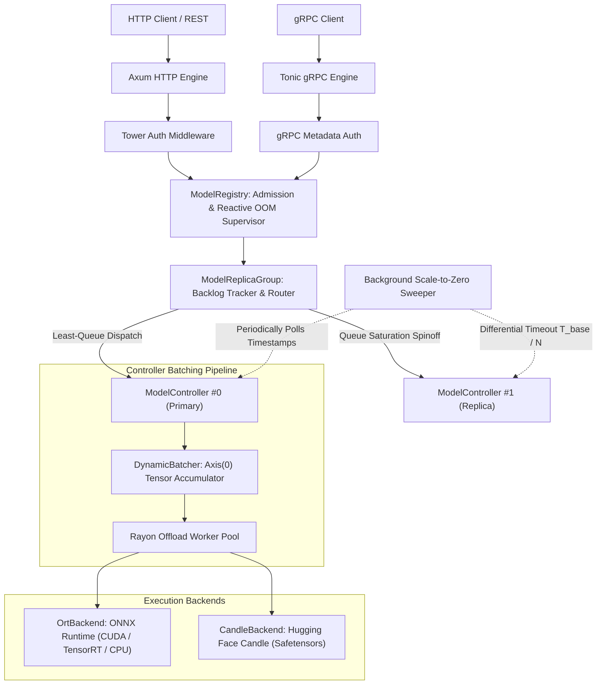

This page provides an architectural breakdown of how SnoozeML is implemented under the hood. It explains how asynchronous network I/O, dynamic tensor micro-batching, hardware execution backends, and background memory sweepers collaborate in a single, high-performance Rust binary.

---

## 1. System Architecture Diagram



---

## 2. Core Internal Subsystems

### 1. Dual-Protocol Network Layer (`src/server/`)
- **Axum HTTP/1.1 & HTTP/2 REST (`src/server/http.rs`)**: Serves JSON inference endpoints (`/v1/models/:id/infer`), model discovery (`/v1/models`), lifecycle control (`/load`, `/unload`), Prometheus metrics (`/metrics`), and HTTP health probes (`/health/*`).
- **Tonic gRPC Service (`src/server/grpc/`)**: Serves high-throughput binary Protobuf inference (`snoozeml.v1.InferenceService`) and official health checks (`grpc.health.v1.Health`). Provides zero-copy buffer bridging and strict dimensional assertions (`src/server/grpc/convert.rs`).
- **Unified Authentication (`src/auth.rs`)**: Constant-time SHA-256 digest validation (`subtle::ConstantTimeEq`) protects API keys against timing attacks across both HTTP headers (`X-API-Key`, `Authorization`) and gRPC metadata (`x-api-key`, `authorization`).
- **Coordinated Graceful Shutdown**: A `tokio::sync::watch` broadcast channel coordinates simultaneous draining of in-flight requests across both HTTP and gRPC listeners upon receiving termination signals.

### 2. Model Registry & Resource Supervisor (`src/registry.rs`)
- **Central Authority**: Stores active models in an asynchronous `Arc<RwLock<HashMap<String, Arc<ModelReplicaGroup>>>>`.
- **Global Allocation Lock**: Serializes model weight loading across threads to prevent memory thrashing and allocation stampedes.
- **Reactive OOM Eviction**: If a backend allocation fails with an explicit Out-Of-Memory error from CUDA or the system allocator, the supervisor automatically evicts the Least Recently Used (LRU) idle model and retries allocation.

### 3. Replica Groups & Pluggable Routing (`src/routing.rs`)
- **Horizontal Scaling**: Encapsulates multiple `ModelController` replicas representing the same underlying model.
- **Autoscaling Decision**: If minimum queue depth across replicas exceeds `autoscale_queue_threshold`, a new replica is spawned dynamically.
- **Dispatching Strategies**: Implements `RoutingStrategy` trait (`least-queue`, `round-robin`, `random`).

### 4. Dynamic Micro-Batch Accumulator (`src/batcher.rs`)
- **Asynchronous Queue**: Uses `tokio::sync::mpsc` and `tokio::sync::oneshot` channels to collate requests.
- **Axis(0) Collation**: Inspects input shapes, asserts trailing dimension equality, and concatenates inputs into a single multi-dimensional tensor.
- **Deadline-Driven Dispatch**: Dispatches immediately upon reaching `max_batch_size` or when the `max_delay_ms` timer fires.
- **Zero-Copy Slicing**: Slices the batched output along `Axis(0)` and sends individual responses back across their respective `oneshot` channels.

### 5. Hardware Backends & Execution Workers (`src/backend/`)
- **Decoupled Compute**: Compute-heavy tensor operations are offloaded from Tokio async worker threads to a dedicated **Rayon thread pool**, preventing compute spikes from blocking network I/O.
- **Unified `ModelBackend` Trait**:
  ```rust,ignore
  pub trait ModelBackend: Send + Sync {
      fn infer(&self, inputs: &[TensorPayload]) -> Result<Vec<TensorPayload>, InferenceError>;
      fn provider_name(&self) -> &'static str;
  }
  ```
- **`OrtBackend`**: Interfaces with ONNX Runtime 2.0 via zero-copy ndarray bridging, supporting CPU, CUDA, and TensorRT.
- **`CandleBackend`**: Pure Rust and CUDA tensor execution for Safetensors models using Hugging Face Candle.

### 6. Background Scale-to-Zero Sweeper (`src/sweeper.rs`)
- **Non-Invasive Polling**: An asynchronous background loop wakes up periodically (e.g. every second).
- **Differential Scale-to-Zero**: Evaluates each model controller's `last_accessed` timestamp. Primary instances deallocate after `idle_timeout_secs`; autoscaled replicas deallocate at accelerated rates:
  $$T_{\text{effective}}(k) = \max\left(\frac{T_{\text{base}}}{N}, 1\text{ms}\right)$$

---

## 3. Zero-Panic Defensive Engineering

In accordance with SnoozeML's architectural principles, production source code enforces a strict **Zero-Panic Policy**:

```rust
#![deny(clippy::unwrap_used, clippy::expect_used, clippy::panic)]
```

- **Bounds Checking**: Slices and vectors are never indexed with raw brackets (`vec[i]`). All accesses use `.get()` with explicit pattern matching.
- **Checked Arithmetic**: Arithmetic operations on external inputs use `checked_add`, `checked_mul`, or saturating casts to prevent integer overflows.
- **Error Bubbling via `thiserror`**: All fallible paths bubble structured `InferenceError` variants upward, preserving error context for logging and telemetry.