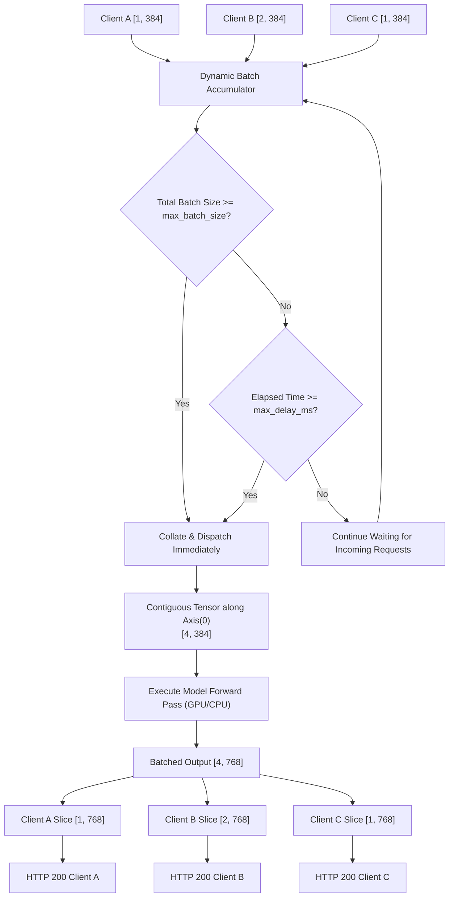

Modern hardware accelerators (NVIDIA GPUs, Apple Silicon Neural Engines, and multi-core CPUs with AVX-512) are designed for massive data parallelism. When a GPU processes an input tensor of batch size 1, most of its compute cores (CUDA cores / Tensor cores) sit idle waiting for memory bandwidth. 

Traditional inference architectures force application developers to implement complex client-side batching queues. **SnoozeML eliminates this complexity with server-side dynamic micro-batching.**

---

## 1. How Dynamic Batching Works

Clients send requests independently without any cross-client synchronization. Each request can contain an input tensor with an arbitrary batch dimension (e.g., a single item `[1, 3, 224, 224]` or multiple items `[4, 3, 224, 224]`).

Inside SnoozeML, the model's `DynamicBatcher` collects requests in an asynchronous queue governed by two triggers:



### The Dual-Trigger Mechanism

1. **Capacity Trigger (`max_batch_size`)**:
   - If the sum of batch items in the queue reaches `max_batch_size`, the batch is sealed and dispatched to the execution worker immediately, without waiting for the timer.
2. **Latency Budget (`max_delay_ms`)**:
   - When the first request arrives in an empty queue, a timer starts (`tokio::time::sleep_until(deadline)`).
   - If `max_delay_ms` elapses before the queue reaches full capacity, whatever requests have accumulated are dispatched as a partial batch.

This dual-trigger mechanism guarantees that **latency is strictly bounded**: a request will never wait longer than `max_delay_ms` before execution begins.

---

## 2. Tensor Collation Along `Axis(0)`

Dynamic batching operates along the leading batch dimension (`Axis(0)`):

1. **Validation**: SnoozeML inspects the incoming tensors from all queued requests to verify that their trailing dimensions match. For example, tensors of shapes `[1, 3, 224, 224]` and `[3, 3, 224, 224]` both have trailing dimensions `[3, 224, 224]`.
2. **Contiguous Concatenation**: The input buffers are concatenated along `Axis(0)` into a single contiguous multi-dimensional array of shape `[4, 3, 224, 224]`.
3. **Execution**: The single batched tensor is passed to the underlying runtime (ONNX Runtime or Candle).
4. **Zero-Copy Slicing**: When the execution finishes and returns output tensors (e.g. `[4, 1000]`), SnoozeML slices the outputs along `Axis(0)` matching the original offset and length of each request:
   - Client A receives index `[0..1]`
   - Client B receives index `[1..3]`
   - Client C receives index `[3..4]`
5. **Channel Dispatch**: Each slice is transmitted directly to the client's waiting HTTP response channel via a dedicated `tokio::sync::oneshot` channel.

---

## 3. Configuration & Tuning Guidelines

You can configure batching parameters globally in `[defaults]` or customize them for specific models in `models.toml`:

```toml
[[models]]
id = "image-classifier"
path = "resnet50.onnx"
# Tune for high throughput:
max_batch_size = 32
max_batch_delay_ms = 5
```

### Choosing the Right Values

| Workload Type | `max_batch_size` | `max_delay_ms` | Rationale |
| :--- | :--- | :--- | :--- |
| **Real-time User-Facing** (e.g. autocomplete, interactive search) | `8` – `16` | `2` – `5` ms | Minimizes tail latency while still allowing modest micro-batching under concurrency spikes. |
| **Balanced API Gateway** (default) | `16` | `10` ms | Ideal general-purpose balance between high throughput and sub-15ms response times. |
| **High-Throughput Offline Processing** (e.g. log ingestion, bulk embeddings) | `64` – `128` | `20` – `50` ms | Allows deep queues to coalesce into massive batches, maximizing GPU saturation. |

---

## 4. Monitoring Batching Efficiency

To measure how well dynamic micro-batching is performing in your environment, query the Prometheus metrics endpoint:

```bash
curl -s http://localhost:8080/metrics | grep snoozeml_
```

Key indicators:
- `snoozeml_requests_total`: Total individual client requests received.
- `snoozeml_batches_dispatched_total`: Total forward passes executed by the backend.

$$\text{Average Batch Size} = \frac{\text{snoozeml\_requests\_total}}{\text{snoozeml\_batches\_dispatched\_total}}$$

- An average batch size close to `1.0` indicates light traffic where requests are dispatched individually upon timer expiry.
- An average batch size substantially greater than `1.0` (e.g. `8.5` or `14.2`) indicates that dynamic micro-batching is actively combining requests and multiplying your throughput!