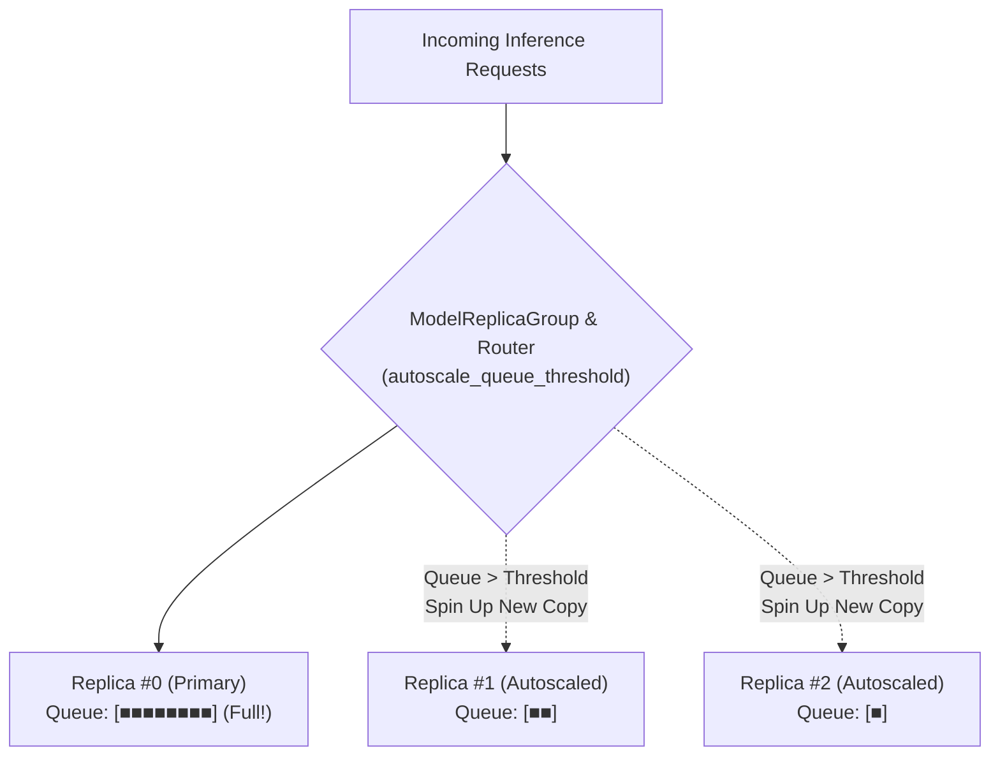

When a single model instance is saturated with incoming requests, dynamic micro-batching alone cannot eliminate queuing delays. To handle extreme concurrency spikes, SnoozeML supports **horizontal replica autoscaling** of the same model on a single host.

---

## 1. How Replica Autoscaling Works

Every registered model is supervised by a `ModelReplicaGroup`. The replica group monitors request queues across all running instances:



### The Scaling Decision Loop
1. When a new inference request arrives, the router inspects the queue backlog of existing replicas.
2. If the minimum queue backlog exceeds `autoscale_queue_threshold`, and the current replica count has not reached `max_replicas`:
   - SnoozeML allocates a new `ModelController` replica for that model.
   - It attempts to initialize the model backend into memory.
   - If physical memory is saturated, the reactive OOM supervisor will attempt to evict an idle LRU candidate. If memory cannot be freed, SnoozeML gracefully falls back to routing to the least-busy existing replica rather than dropping the request.
3. The request is dispatched to the chosen replica.

---

## 2. Pluggable Routing Strategies

SnoozeML includes multiple load-balancing strategies to distribute traffic among identical model replicas:

### 1. `least-queue` (Default & Recommended)
Compares `(queue_len, active_requests)` across all loaded replicas and routes each incoming request to the replica with the smallest aggregate backlog:
```toml
routing_strategy = "least-queue"
```
This strategy dynamically compensates for variations in request complexity and input tensor sizes, delivering the lowest overall tail latency.

### 2. `round-robin`
Evenly alternates requests sequentially across all active replicas:
```toml
routing_strategy = "round-robin"
```

### 3. `random`
Distributes requests uniformly at random across active replicas:
```toml
routing_strategy = "random"
```

---

## 3. Replica Ceilings: Bounded vs. Unbounded Scaling

You can specify how many replicas a model is allowed to spawn:

```toml
[[models]]
id = "search-embedder"
path = "model.onnx"
# Limit to at most 4 parallel instances:
max_replicas = 4
autoscale_queue_threshold = 8
```

### Unbounded Scaling (`max_replicas = 0`)
By default, `max_replicas` is **unbounded** (omitted or set to `0`). In unbounded mode, SnoozeML will continue spinning up replicas to meet surging demand until:
- Hardware memory (RAM/VRAM) is fully saturated.
- Or the daemon-wide `max_loaded_models` ceiling is reached.

---

## 4. Differential Scale-to-Zero for Replicas

When traffic subsides after a spike, keeping multiple idle replicas resident in memory would waste hardware resources. SnoozeML employs a **differential scale-to-zero algorithm**:

$$T_{\text{effective}}(k) = \begin{cases} T_{\text{base}} & \text{if } k = 0 \text{ (Primary Replica)} \\ \max\left(\frac{T_{\text{base}}}{N}, 1\text{ms}\right) & \text{if } k \ge 1 \text{ (Autoscaled Replicas)} \end{cases}$$

Where:
- $k$: Replica index ($0$ is primary, $1..N-1$ are auto-scaled copies).
- $T_{\text{base}}$: Configured `idle_timeout_secs` (e.g. 300 seconds).
- $N$: Current total number of active replicas for this model.

### Practical Example

Suppose a model with `idle_timeout_secs = 300` scales up to **4 replicas** during a burst:
1. When traffic stops, $N = 4$.
2. The auto-scaled replicas ($k = 1, 2, 3$) evaluate their effective idle timeout as:
   $$T_{\text{effective}} = \frac{300}{4} = 75 \text{ seconds}$$
3. After 75 seconds of inactivity, the extra replicas are deallocated one by one, releasing memory back to the system.
4. The primary replica ($k = 0$) remains alive for the full 300 seconds, maintaining warm-start readiness for subsequent traffic.