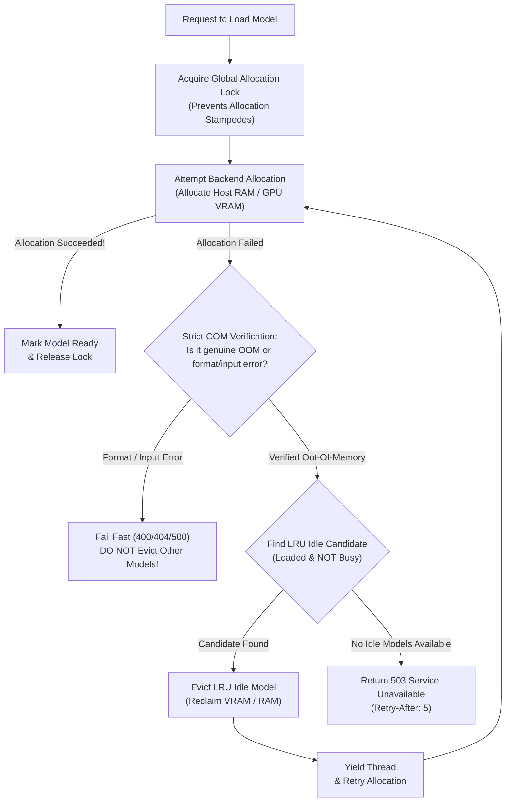

In multi-model deployments, running out of host RAM or GPU VRAM is one of the most critical operational hazards. Traditional inference servers crash or fail requests with fatal `500 Internal Server Error` exceptions when memory is exhausted.

SnoozeML features a **reactive, opportunistic resource manager** that intercepts Out-Of-Memory (OOM) conditions at runtime and automatically frees memory by deallocating idle models.

---

## 1. The Reactive Deallocation Loop

When a model needs to be loaded into memory, SnoozeML's allocation supervisor coordinates the process:



---

## 2. Strict OOM Verification: Preventing False Evictions

A critical architectural guarantee of SnoozeML is **never treating generic exceptions as OOM errors**:

:::danger
If a model fails to load because its weights file is missing, corrupted, or specifies an unsupported layer architecture, treating that error as an out-of-memory condition would cause the server to erroneously deallocate healthy, running models in a futile attempt to make room.
:::

SnoozeML uses strict, high-confidence pattern matching on backend error payloads:
- **Candle**: Direct inspection of `candle_core::Error::OutOfMemory` and CUDA driver error `CUDA_ERROR_OUT_OF_MEMORY` (code 2).
- **ONNX Runtime**: Specific matching on `std::bad_alloc`, allocator OOM return codes, or explicit driver OOM messages (`"CUDA failure 2: out of memory"`).
- **Non-OOM Errors**: File not found (404), invalid shapes (400), or unsupported layers (501) fail immediately without touching other resident models.

---

## 3. LRU Eviction Rules

A model instance is eligible for LRU deallocation if and only if:
1. It currently holds allocated weights in memory (`backend.is_some()`).
2. It does not belong to the target model currently attempting to allocate.
3. Its state is `Ready` or `Idle` (i.e. **not `Busy`** executing inference).
4. Its active request count is zero (pinned models with in-flight requests are never evicted).

Eligible candidates are sorted ascending by their `last_accessed` timestamp, and the oldest idle model is evicted first.

---

## 4. Anti-Thrashing Safeguards

**Thrashing** occurs when two large models (Model A and Model B) repeatedly deallocate each other on consecutive requests (a "ping-pong" effect). 

To prevent thrashing:
- **Minimum Residency (`min_residency_secs`)**: By default, a newly loaded model cannot be evicted for at least 10 seconds unless all other idle candidates have already been deallocated.
- **Preemptive Capacity Capping (`max_loaded_models`)**: You can set an explicit cap on total simultaneously loaded models in `models.toml`:
  ```toml
  [defaults]
  max_loaded_models = 3
  min_residency_secs = 10
  ```

---

## 5. Client Handling: HTTP 503 & Backoff

If all resident models are actively busy processing batches and memory is completely exhausted, SnoozeML returns:

```http
HTTP/1.1 503 Service Unavailable
Retry-After: 5
Content-Type: application/json

{
  "error": "Resource limit reached: cannot allocate model even after deallocating idle sessions: Out of memory loading 'large-model'. All active models are currently busy."
}
```

This signals upstream load balancers, client SDKs, or retry middleware to wait briefly before retrying, rather than failing permanently with `500 Internal Server Error`.