Serving machine learning models in production presents a classic trade-off between **resource cost** and **inference latency**:

- If you keep every model continuously loaded in GPU memory, your idle cloud bill skyrockets.
- If you shut down instances completely, users suffer multi-second cold-start penalties when new requests arrive.

SnoozeML resolves this dilemma by implementing a **multi-tier adaptive scaling architecture** entirely inside a single lightweight daemon. Understanding how these mechanics interact will allow you to tune the system for your exact latency, throughput, and hardware constraints.

---

## 1. The Four Pillars of SnoozeML Scaling

```mermaid
graph TD
    subgraph P1 ["1. Dynamic Micro-Batching"]
        A[Incoming Concurrent Requests] --> B["Batch Accumulator<br>max_batch_size & max_delay_ms"]
        B --> C["Contiguous Batch Tensor along Axis(0)"]
    end

    subgraph P2 ["2. Scale-to-Zero Lifecycle"]
        D["Idle Timer (idle_timeout)"] --> E["Drop Backend Weights<br>0 MB VRAM / RAM"]
        F["Incoming Request"] --> G["Lazy Rehydration<br>(Sub-second Cold Start)"]
    end

    subgraph P3 ["3. Dynamic Replica Autoscaling"]
        H["Queue Backlog > autoscale_queue_threshold"] --> I["Spin Up Additional Replicas"]
        I --> J["Pluggable Routing<br>(Least-Queue, Round-Robin)"]
    end

    subgraph P4 ["4. Reactive OOM Prevention"]
        K["Physical VRAM/RAM Saturated"] --> L["Strict OOM Detection"]
        L --> M["Evict LRU Idle Models"]
        M --> N["Retry Allocation"]
    end
```



1. **Dynamic Micro-Batching along `Axis(0)`**: Combines independent client requests within a millisecond window into a single batch tensor, drastically boosting throughput without requiring client-side batching.
2. **Scale-to-Zero Lifecycle**: Frees model weights from memory after periods of inactivity, dropping idle resource consumption to zero.
3. **Horizontal Replica Autoscaling**: Detects queue buildup under heavy traffic, allocates parallel model controller replicas, and balances traffic across them.
4. **Reactive OOM Prevention & LRU Eviction**: Intercepts memory exhaustion at the driver/allocator level and transparently evicts idle models to make room for active workloads.

---

## 2. Request Lifecycle & Execution Timeline

When an HTTP inference request reaches SnoozeML, it passes through the following lifecycle:

```text
Time (ms)  Request Flow & Lifecycle Event
 0.00 ms   ──> HTTP POST /v1/models/my-model/infer arrives at Axum server
 0.05 ms   ──> Authentication Middleware verifies API key / JWT token (constant-time)
 0.10 ms   ──> ModelReplicaGroup queries queue depths across available replicas
               │
               ├─ If Model is IDLE: Lazy Cold Start triggered!
               │  Weights streamed from disk/page cache into VRAM/RAM (~10ms–150ms)
               │
               ├─ If queue > autoscale_queue_threshold:
               │  Spins up a new replica (if within max_replicas ceiling)
               │
 0.15 ms   ──> Dispatched to chosen replica's DynamicBatcher
 0.20 ms   ──> Batch accumulator holds request:
               │  - Dispatches immediately if batch reaches max_batch_size (e.g. 16)
               │  - Or waits until max_delay_ms budget expires (e.g. 10 ms)
               │
 5.00 ms   ──> Batch dispatched! Rayon thread pool executes forward pass
 8.00 ms   ──> Batched output un-sliced along Axis(0) back to individual requests
 8.10 ms   ──> Sliced response transmitted to client HTTP stream (200 OK)
```

---

## 3. What to Expect in Real-World Operation

### Scenario A: Steady, Low Traffic (Single Requests)
- **Behavior**: Requests arrive every few seconds.
- **Latency**: After the initial cold start, every request is processed with minimal queuing latency (at most `max_delay_ms`, e.g., 5–10 ms plus model compute time).
- **Resource Usage**: The model remains memory-resident as long as requests arrive within `idle_timeout` seconds of each other.

### Scenario B: Traffic Burst / Concurrent Load
- **Behavior**: 20 clients send requests simultaneously.
- **Dynamic Batching**: Rather than executing 20 separate forward passes (which would serialize and cause queuing delays), the batch accumulator combines up to `max_batch_size` (e.g., 16) requests into a single forward pass.
- **Throughput Gain**: Hardware accelerators (GPUs and vectorized CPUs) process batched tensors with near-linear parallel efficiency. Throughput typically increases by 4x to 12x compared to serial execution!

### Scenario C: Sustained Heavy Traffic (Autoscaling)
- **Behavior**: Inflow exceeds the capacity of a single batch accumulator, causing queue depth to exceed `autoscale_queue_threshold`.
- **Replica Scaling**: SnoozeML allocates a second replica of the model and begins routing incoming traffic using the `least-queue` strategy.
- **Result**: Queue delays drop back down, preventing client timeouts.

### Scenario D: Traffic Subsides (Scale-to-Zero)
- **Behavior**: Requests stop arriving.
- **Differential Pruning**: Excess replicas deallocate much faster than the primary replica ($T_{effective} = T_{base} / N$). For example, if there are 4 replicas and `idle_timeout = 300s`, excess replicas shut down in `75s`.
- **Total Deallocation**: Once the primary instance has been idle for the full `300s`, its weights are released. Memory drops back to baseline.

### Scenario E: Memory Saturated (High Model Diversity)
- **Behavior**: 10 different models are called on a GPU that only fits 3 models simultaneously.
- **Reactive Eviction**: SnoozeML identifies the Least Recently Used (LRU) model that is currently idle, evicts its weights from VRAM, and initializes the new model in its place.
- **Zero Downtime**: Active models currently processing batches are never evicted.