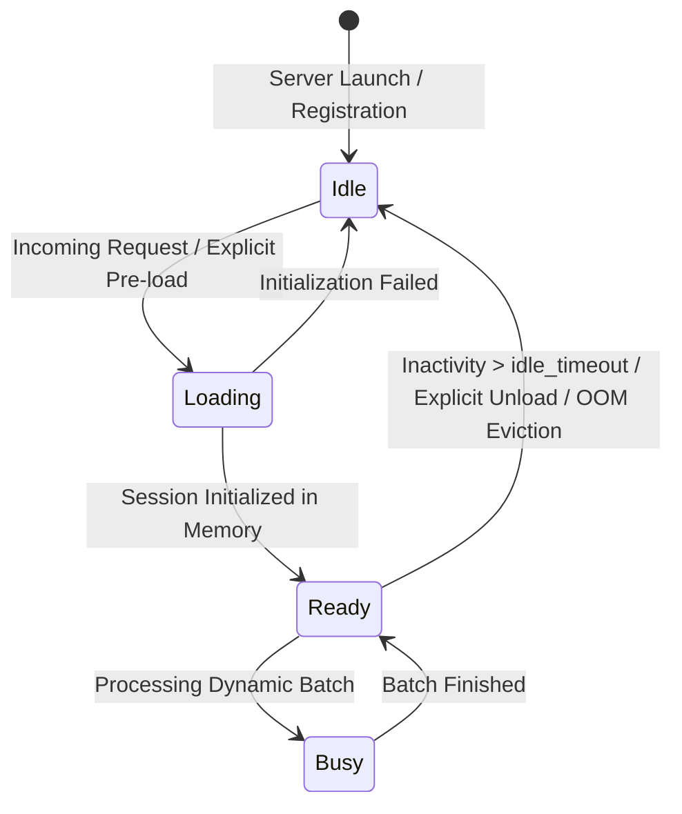

One of the foundational design principles of SnoozeML is **zero-idle resource consumption**. In standard machine learning deployments, GPU VRAM and host RAM are occupied by model weights even when no traffic is being served. SnoozeML changes this paradigm by reclaiming memory when models become idle.

---

## 1. The Model State Machine

Every model registered with SnoozeML follows a well-defined, thread-safe state machine:



- **`Idle`**: The model is registered in the routing table, but **no weights reside in RAM or GPU VRAM** (0 MB memory allocated).
- **`Loading`**: Weights are being streamed from disk into system memory or GPU VRAM.
- **`Ready`**: Model weights are fully resident in memory, and the model is actively accepting inference requests with warm latency.
- **`Busy`**: The execution worker is currently running a forward pass on an assembled micro-batch.
- **Background Sweeper**: A lightweight background task periodically scans registered models and triggers `sweep_scale_to_zero()` to transition inactive `Ready` models back to `Idle`.

---

## 2. What to Expect from Cold Starts

When a request arrives for a model in the `Idle` state, SnoozeML triggers a **lazy cold start**:

1. The request thread is paused asynchronously while the model backend initializes.
2. Model weights are read from disk (or OS filesystem page cache) and uploaded to the accelerator device.
3. Once initialized, the model enters `Ready` and immediately executes the pending request.
4. Subsequent requests experience **warm latency** as long as they arrive before `idle_timeout` expires.

### Cold Start Latency vs. Warm Latency

| Model & Architecture | Typical Warm Latency | Typical Cold Start Latency (NVMe SSD) |
| :--- | :--- | :--- |
| **`all-MiniLM-L6-v2`** (Embeddings, ~90 MB) | `2` – `5` ms | `30` – `80` ms |
| **`resnet50`** (Vision, ~100 MB) | `4` – `8` ms | `60` – `120` ms |
| **`bge-base-en-v1.5`** (Safetensors, ~440 MB) | `6` – `12` ms | `120` – `250` ms |
| **`clip-vit-base`** (Multimodal, ~600 MB) | `10` – `20` ms | `200` – `450` ms |

### Factors Affecting Cold Start Speed
- **Disk Storage**: Fast NVMe PCIe Gen4/Gen5 SSDs dramatically reduce weight loading times.
- **OS Page Cache**: If the model was recently used, the OS page cache retains the file in RAM, making rehydration significantly faster.
- **Safetensors Memory Mapping**: Safetensors models utilize zero-copy memory mapping (`mmap`), allowing near-instantaneous mapping into memory.

---

## 3. Configuring Idle Timeouts

You can configure how long a model stays in memory after its last request using `idle_timeout_secs`:

```toml
# In models.toml:

# Global default: release after 5 minutes of inactivity
[defaults]
idle_timeout_secs = 300

# High-frequency model: keep in memory for 1 hour
[[models]]
id = "primary-search-embedder"
path = "embeddings.onnx"
idle_timeout_secs = 3600

# Infrequent model: release quickly after 60 seconds
[[models]]
id = "monthly-fraud-detector"
path = "fraud.onnx"
idle_timeout_secs = 60
```

---

## 4. Pre-Warming Models (Avoiding Cold Starts)

In production, you may want to prevent user-facing cold starts during scheduled peak hours. SnoozeML allows you to **pre-warm** models ahead of time without sending dummy inference data:

### Using the CLI
```bash
snooze load --model-id primary-search-embedder
```

### Using HTTP REST
```bash
curl -X POST http://127.0.0.1:8080/v1/models/primary-search-embedder/load
```

Once loaded, the model remains `Ready` and immediately serves incoming requests at warm latency.

---

## 5. Explicit Deallocation (Immediate Memory Release)

To immediately deallocate a model's weights and reclaim memory without waiting for `idle_timeout`:

### Using the CLI
```bash
snooze unload --model-id monthly-fraud-detector
```

### Using HTTP REST
```bash
curl -X POST http://127.0.0.1:8080/v1/models/monthly-fraud-detector/unload
```