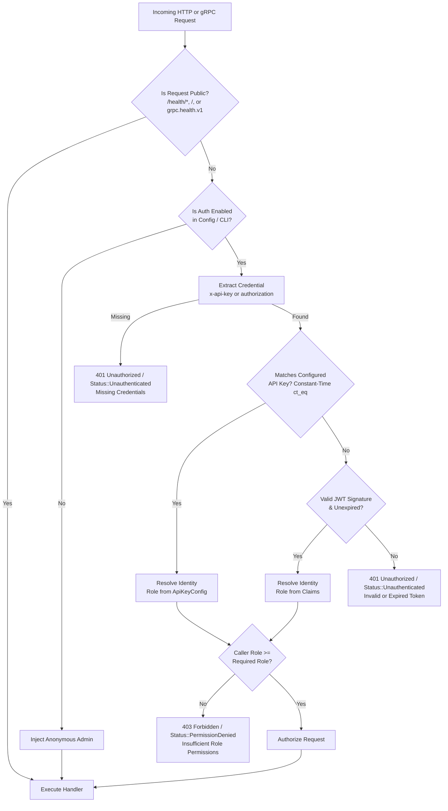

SnoozeML includes a high-performance, asynchronous authentication and Role-Based Access Control (RBAC) layer. It protects both **HTTP REST** endpoints (via Axum/Tower middleware) and **gRPC** endpoints (via Tonic metadata interception and service authentication).

When enabled, the security layer inspects incoming HTTP request headers or gRPC metadata, validates credentials against configured static API keys or cryptographic JSON Web Tokens (JWT), and verifies that the caller possesses sufficient role permissions for the target operation.

---

## 1. Core Architecture & Request Flow



---

## 2. Key Security Properties

- **Constant-Time Timing-Safe Comparisons**: API keys are hashed with SHA-256 and evaluated using constant-time digest equality checks (`subtle::ConstantTimeEq`). This prevents timing side-channel attacks from leaking key bytes across both HTTP and gRPC.
- **Dual Bearer Resolution**: Supports both explicit `X-API-Key` headers (or `x-api-key` in gRPC metadata) and standard `Authorization: Bearer <key-or-token>` headers, allowing seamless integration with standard ML client SDKs.
- **Public Orchestrator Probes**: Kubernetes and container liveness/readiness probes (`/health/live`, `/health/ready`, and standard `grpc.health.v1.Health/Check`) and service metadata (`/`) are public by default, allowing container platforms to monitor daemon health without needing access to API secrets.
- **Unified Identity Resolution**: Both HTTP and gRPC endpoints resolve to the exact same internal `AuthIdentity` model with consistent role enforcement.
- **Strict Cumulative Hierarchy**: Roles follow a strict tier system where higher roles inherit all permissions of lower roles.

---

## 3. The 3-Tier Role Hierarchy

Permissions in SnoozeML are organized into three cumulative roles:

$$\text{Admin} > \text{Inference} > \text{ReadOnly}$$

| Role | Access Level & Permissions | Typical Use Case |
| :--- | :--- | :--- |
| **`Admin`** | **Full Access**: Can perform inference, view models, pre-load models, force deallocation (scale-to-zero), and scrape protected metrics. | Cluster operators, DevOps automation, CI/CD deployment scripts. |
| **`Inference`** | **Inference & Inspection**: Can execute inference (`POST /v1/models/:id/infer`) and view model metadata (`GET /v1/models`). Cannot force load/unload. | Application backends, frontend microservices, user applications. |
| **`ReadOnly`** | **Metadata Inspection Only**: Can inspect registered models and states (`GET /v1/models`). Cannot execute inference or manage lifecycles. | Monitoring crawlers, dashboard crawlers, audit pipelines. |

---

## 4. Enabling Authentication

Authentication can be enabled in three ways:

1. **Via `models.toml`**:
   ```toml
   [auth]
   enabled = true
   protect_metrics = false # Optional: require Admin role on /metrics
   ```
2. **Via Environment Variables**:
   Setting `SNOOZE_API_KEY` (defaults to Admin role, or `<role>:<key>`), `SNOOZE_API_KEYS` (comma-separated list), role-specific variables (`SNOOZE_API_KEY_ADMIN`, `SNOOZE_API_KEY_INFER`, `SNOOZE_API_KEY_READONLY`), or `SNOOZE_JWT_SECRET` automatically activates authentication and verifies credentials without needing any secrets in `models.toml`.
3. **Via CLI flags on `snooze serve`**:
   Passing any `--api-key` or `--jwt-secret` flag automatically activates authentication enforcement. You can also explicitly pass `--auth-enabled`.
