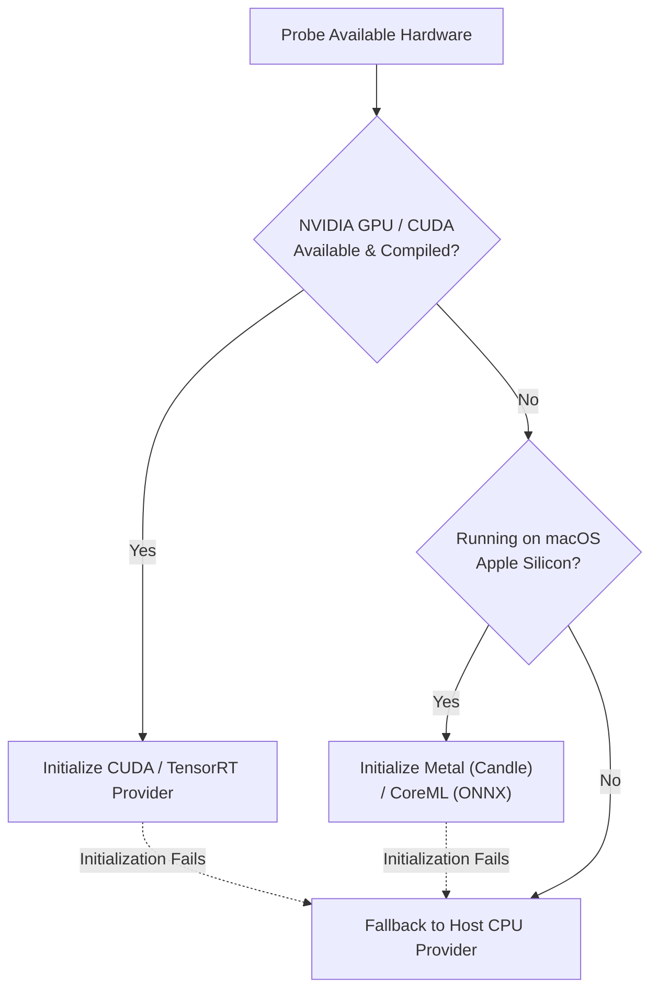

SnoozeML supports modular execution providers across NVIDIA GPUs, Apple Silicon hardware, and host multi-core CPUs. Hardware acceleration applies transparently across both ONNX Runtime (`ort`) and Hugging Face Candle backends.

---

## 1. Automatic Device Resolution (`"auto"`)

By default, SnoozeML operates in **`auto` mode** (`device = "auto"` in `models.toml` or `--provider auto` on the CLI). In this mode, the runtime dynamically probes and selects the best available hardware accelerator in priority order:



1. **NVIDIA CUDA / TensorRT**: Attempted first if the binary was compiled with GPU feature flags and a compatible NVIDIA driver/GPU is present.
2. **Apple Silicon (macOS)**: On Apple Silicon hardware (M1/M2/M3/M4), attempts CoreML for ONNX models and Metal compute kernels for Candle/Safetensors.
3. **Multi-Threaded CPU**: Safe universal fallback. If GPU or hardware initialization encounters driver mismatches, SnoozeML logs a warning and falls back to host CPU rather than failing.

---

## 2. Explicit Device Configuration

You can override `"auto"` mode globally in `models.toml` or on individual models:

```toml
# Set global default
[defaults]
device = "cuda"

# Override for a specific lightweight model to save GPU VRAM
[[models]]
id = "quick-classifier"
path = "classifier.onnx"
device = "cpu"
```

### Supported Device Identifiers

| Identifier | Target Hardware | Execution Provider |
| :--- | :--- | :--- |
| `"auto"` | Automatic resolution | Highest priority available accelerator |
| `"cuda"`, `"gpu"` | NVIDIA GPU | ONNX `CUDAExecutionProvider` / Candle CUDA Device |
| `"tensorrt"` | NVIDIA GPU | ONNX `TensorRTExecutionProvider` |
| `"mlx"`, `"metal"`, `"coreml"` | Apple Silicon | ONNX `CoreMLExecutionProvider` / Candle Metal Device |
| `"cpu"` | Host CPU | ONNX `CPUExecutionProvider` / Candle CPU Device |

---

## 3. NVIDIA CUDA & TensorRT Setup

### Prerequisites
- NVIDIA GPU with Compute Capability >= 6.0 (Pascal, Turing, Ampere, Ada Lovelace, Hopper).
- NVIDIA Display Driver >= 525.60.13.
- CUDA Toolkit 11.8 or 12.x and cuDNN library.

### Building with CUDA
Compile SnoozeML with the `cuda` feature flag:

```bash
cargo build --release --features cuda
```

### Building with TensorRT
TensorRT optimizes deep learning models with layer fusion, kernel tuning, and mixed-precision (FP16/INT8) execution:

```bash
cargo build --release --features tensorrt
```

---

## 4. Apple Silicon (macOS) Acceleration

On macOS, SnoozeML takes advantage of Apple Silicon's Unified Memory Architecture (UMA), where CPU and GPU share the same ultra-high-bandwidth memory pool.

- **Candle / Safetensors**: Automatically utilizes Metal GPU shaders out-of-the-box.
- **ONNX Models**: Compile with the `coreml` feature flag:
  ```bash
  cargo build --release --features coreml
  ```

---

## 5. Host CPU Optimization

When running on CPU (e.g. edge gateways or cost-effective cloud VMs without GPUs):
- **Rayon Concurrency**: SnoozeML offloads compute-heavy forward passes to a dedicated Rayon thread pool, ensuring async network I/O remains completely non-blocking.
- **SIMD Vectorization**: ONNX Runtime and Candle automatically leverage vector instructions supported by your CPU architecture (AVX2, AVX-512, FMA, or ARM NEON).

---

## 6. Verifying Active Provider

When a model is initialized, SnoozeML emits structured tracing telemetry stating the active provider:

```text
2026-09-27T12:05:00.123Z  INFO snooze_ml::backend::ort: Initialized ONNX backend model_id=resnet50 provider="CUDAExecutionProvider" device="cuda:0"
```

You can also verify provider status live via the REST API or terminal monitor:

```bash
curl -s http://127.0.0.1:8080/v1/models | jq '.[].device'
```