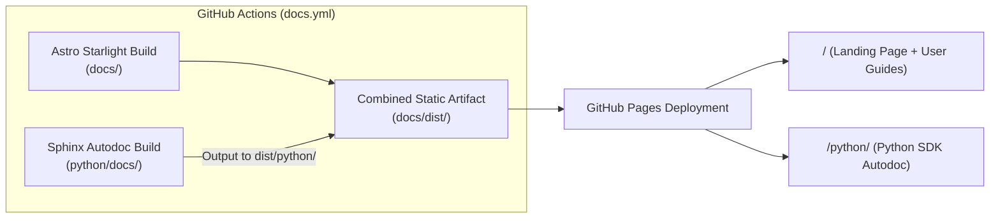

# SnoozeML Documentation Transition Plan (mdBook $\rightarrow$ Astro Starlight + Sphinx)

This document outlines the step-by-step transition plan to replace `mdBook` (`docs/`) with **Astro Starlight** as the primary documentation & product portal while seamlessly integrating the **Sphinx** Python SDK API Reference (`python/docs/` using the **Shibuya** theme) into a single unified GitHub Pages deployment.

---

## 1. Target Architecture & URL Topology



| Path on GitHub Pages | Generator | Source Directory | Purpose |
| :--- | :--- | :--- | :--- |
| `/` | Astro Starlight | `docs/src/content/docs/index.mdx` | Marketing hero page, feature grid, architecture highlights, quickstart |
| `/getting-started/*`, `/serving/*`, etc. | Astro Starlight | `docs/src/content/docs/**` | All 34 existing Markdown guides migrated from `docs/src/` |
| `/python/` | Sphinx (`shibuya` theme) | `python/docs/` + `python/snoozeml/` | Auto-generated Python SDK reference (`autodoc`, `napoleon`, `viewcode`) |

---

## 2. Phase-by-Phase Migration Plan

### Phase 1: Scaffold Astro Starlight in `docs/`
Instead of keeping `mdBook` files (`docs/book.toml`, `docs/mermaid.min.js`, `docs/mermaid-init.js`), initialize an Astro Starlight project inside `docs/`:

1. **Initialize project files in `docs/`:**
   * Create `docs/package.json`, `docs/astro.config.mjs`, `docs/tsconfig.json`, and `docs/src/content.config.ts`.
   * Install Starlight plus plugins for Mermaid diagrams and LaTeX math (which `docs/book.toml` currently enables via `mathjax-support = true` and `mdbook-mermaid`):
     ```bash
     npm create astro@latest -- --template starlight
     npm install rehype-katex remark-math astro-mermaid mermaid
     ```
2. **Move Markdown files to Starlight's content collection:**
   * Move existing Markdown files from `docs/src/<section>/<page>.md` $\rightarrow$ `docs/src/content/docs/<section>/<page>.md`.
   * Remove legacy `mdBook` artifacts: `docs/book.toml`, `docs/src/SUMMARY.md`, `docs/mermaid.min.js`, and `docs/mermaid-init.js`.
   * Add `docs/node_modules/` and `docs/dist/` to `.gitignore`.

---

### Phase 2: Migrate Markdown Frontmatter & Syntax
Starlight uses standard CommonMark/GFM with YAML frontmatter at the top of each file.

1. **Automated Frontmatter Injection:**
   Every Markdown file in `docs/src/content/docs/` requires a `title` in YAML frontmatter (replacing the top `# Heading` in each file):
   ```markdown
   ---
   title: Dynamic Micro-Batching
   description: How SnoozeML coalesces concurrent inference requests along Axis(0).
   ---
   ```
   *(A 20-line Python script can automatically extract the first `# Heading` from all 34 `.md` files in `docs/src/` and write the YAML frontmatter).*

2. **Admonitions / Callouts Compatibility:**
   * `mdBook` uses GitHub-style alerts (`> [!NOTE]`, `> [!WARNING]`, `> [!IMPORTANT]`, `> [!TIP]`).
   * Starlight supports `:::note` directives natively, or you can enable `remark-github-beta-blockquote-admonitions` so all existing `> [!NOTE]` blocks work with **zero changes**.

3. **Internal Links Cleanup:**
   * In `docs/src/`, links currently include `.md` extensions (e.g., `[Getting Started](./getting-started/installation.md)`).
   * Update internal links to extensionless paths (`/SnoozeML/getting-started/installation/`) or configure a remark plugin to strip `.md` links automatically at build time.

---

### Phase 3: Configure Sidebar & Hero Landing Page (`docs/astro.config.mjs`)
Translate `docs/src/SUMMARY.md` directly into Starlight's `sidebar` configuration in `docs/astro.config.mjs`, and add a cross-link to the Sphinx Python SDK docs:

```javascript
// docs/astro.config.mjs
import { defineConfig } from 'astro/config';
import starlight from '@astrojs/starlight';
import remarkMath from 'remark-math';
import rehypeKatex from 'rehype-katex';

export default defineConfig({
  site: 'https://snoozeml.github.io',
  base: '/SnoozeML',
  markdown: {
    remarkPlugins: [remarkMath],
    rehypePlugins: [rehypeKatex],
  },
  integrations: [
    mermaid(),
    starlight({
      title: 'SnoozeML',
      description: 'Single-binary, scale-to-zero ML inference daemon in Rust',
      social: {
        github: 'https://github.com/SnoozeML/SnoozeML',
      },
      customCss: [
        'katex/dist/katex.min.css',
      ],
      sidebar: [
        { label: 'Introduction', slug: 'introduction' },
        {
          label: 'Getting Started',
          items: [
            'getting-started/installation',
            'getting-started/quickstart',
            'getting-started/downloading-models',
          ],
        },
        {
          label: 'Serving Models',
          items: [
            'serving/starting-the-server',
            'serving/configuration',
            'serving/hardware-acceleration',
            'serving/supported-formats',
            'serving/custom-models',
          ],
        },
        {
          label: 'Scaling & Performance Mechanics',
          items: [
            'scaling/overview',
            'scaling/dynamic-batching',
            'scaling/scale-to-zero',
            'scaling/horizontal-autoscaling',
            'scaling/memory-and-oom',
          ],
        },
        {
          label: 'Authentication & Security',
          items: [
            'security/overview',
            'security/api-keys',
            'security/jwt',
            'security/endpoint-security',
          ],
        },
        {
          label: 'Client Usage & Inference',
          items: [
            'client/python-sdk',
            {
              label: 'Python SDK API Reference (Sphinx) ↗',
              link: '/SnoozeML/python/',
              attrs: { target: '_blank' },
            },
            'client/inference-requests',
            'client/grpc-inference',
            'client/tensors',
            'client/errors',
          ],
        },
        {
          label: 'Event Streaming & Message Brokers',
          items: [
            'streaming/quickstart',
            'streaming/overview',
            'streaming/configuration',
          ],
        },
        {
          label: 'Operations & Monitoring',
          items: [
            'operations/tui-monitor',
            'operations/model-lifecycle',
            'operations/health-probes',
            'operations/prometheus-metrics',
            'operations/production',
          ],
        },
        {
          label: 'Reference & Architecture',
          items: [
            'reference/architecture',
            'reference/cli-reference',
            'reference/api-reference',
            'reference/grpc-api-reference',
          ],
        },
      ],
    }),
  ],
});
```

#### Create the Landing Page (`docs/src/content/docs/index.mdx`)
Use Starlight's `template: splash` to give SnoozeML a modern landing page at `/` while keeping the detailed introduction at `/introduction/`:

```mdx
---
title: SnoozeML — Bare-Metal Scale-to-Zero ML Inference Daemon
description: High-performance Rust inference daemon with dynamic micro-batching, scale-to-zero VRAM reclamation, and multi-runtime execution.
template: splash
hero:
  tagline: Serverless scale-to-zero economics meets bare-metal Rust inference performance for ONNX, Safetensors, and XGBoost.
  actions:
    - text: Get Started
      link: /SnoozeML/getting-started/quickstart/
      icon: right-arrow
      variant: primary
    - text: Python SDK Reference
      link: /SnoozeML/python/
      icon: external
      variant: secondary
---

import { Card, CardGrid } from '@astrojs/starlight/components';

<CardGrid stagger>
  <Card title="Zero-Idle Scale-to-Zero" icon="rocket">
    Automatically unloads inactive models from GPU VRAM and host RAM after a configurable idle timeout, with LRU & reactive OOM eviction.
  </Card>
  <Card title="Adaptive Dynamic Micro-Batching" icon="bars">
    Coalesces concurrent HTTP REST, gRPC, and Kafka/NATS requests along `Axis(0)` within sub-millisecond windows.
  </Card>
  <Card title="Multi-Runtime Execution" icon="setting">
    Serve ONNX Runtime (`ort`), Hugging Face Safetensors (`candle`), and pure-Rust GBDT trees (`hessboost`) from a single binary.
  </Card>
  <Card title="Official Python SDK" icon="document">
    Convert Scikit-Learn, PyTorch, and XGBoost models to ONNX and query over HTTP or high-throughput gRPC.
  </Card>
</CardGrid>
```

---

### Phase 4: Modernize the Sphinx Python Docs (`python/docs/`)
To ensure transitioning between Starlight (`/`) and Sphinx (`/python/`) looks visually cohesive:

1. **Update `python/pyproject.toml` (`[project.optional-dependencies].dev`):**
   Replace `sphinx-rtd-theme>=2.0.0` with **`shibuya`**, which provides a modern dark/light UI matching Starlight:
   ```toml
   dev = [
       "pytest>=8.0.0",
       "pytest-asyncio>=0.23.0",
       "mypy>=1.9.0",
       "ruff>=0.3.0",
       "sphinx>=7.2.0",
       "shibuya>=2024.8.0",
   ]
   ```
2. **Update `python/docs/conf.py`:**
   Configure `html_theme = "shibuya"` (with a clean navigation link back to the main Starlight documentation):
   ```python
   html_theme = "shibuya"
   html_theme_options = {
       "nav_links": [
           {
               "title": "← Back to SnoozeML Main Docs",
               "url": "../",
           },
           {
               "title": "Python SDK Guide",
               "url": "../client/python-sdk/",
           },
       ],
   }
   ```

---

## 3. GitHub Actions CI/CD Workflow (`.github/workflows/docs.yml`)

Create `.github/workflows/docs.yml` to build **Starlight** and **Sphinx** in a single fast pipeline (no Rust compilation needed) and publish the combined artifact to GitHub Pages whenever documentation or Python SDK changes are pushed to `main`.

> [!IMPORTANT]
> In your GitHub repository settings, navigate to **Settings $\rightarrow$ Pages** and set **Build and deployment $\rightarrow$ Source** to **GitHub Actions**.

```yaml
# .github/workflows/docs.yml
name: Deploy Documentation to GitHub Pages

on:
  push:
    branches: ["main"]
    paths:
      - "docs/**"
      - "python/**"
      - ".github/workflows/docs.yml"
  workflow_dispatch:

# Allow job to deploy to GitHub Pages
permissions:
  contents: read
  pages: write
  id-token: write

# Allow one concurrent deployment, skipping runs queued between the in-progress and latest
concurrency:
  group: "pages"
  cancel-in-progress: false

jobs:
  build:
    name: Build Starlight + Sphinx
    runs-on: ubuntu-latest
    steps:
      - name: Checkout repository
        uses: actions/checkout@v4

      # 1. Build Astro Starlight (Main Website & User Guides -> docs/dist/)
      - name: Setup Node.js
        uses: actions/setup-node@v4
        with:
          node-version: "20"
          cache: "npm"
          cache-dependency-path: "docs/package-lock.json"

      - name: Install and build Starlight docs
        working-directory: ./docs
        run: |
          npm ci
          npm run build

      # 2. Build Sphinx Python SDK Reference (-> docs/dist/python/)
      - name: Setup Python
        uses: actions/setup-python@v5
        with:
          python-version: "3.12"
          cache: "pip"

      - name: Install Python SDK and Sphinx dependencies
        run: |
          python -m pip install --upgrade pip
          pip install -e "python[full,dev]"

      - name: Build Sphinx HTML into Starlight dist/python
        run: |
          sphinx-build -b html python/docs docs/dist/python

      # 3. Upload combined static site artifact
      - name: Configure GitHub Pages
        uses: actions/configure-pages@v5

      - name: Upload Pages artifact
        uses: actions/upload-pages-artifact@v3
        with:
          path: ./docs/dist

  deploy:
    name: Deploy to GitHub Pages
    environment:
      name: github-pages
      url: ${{ steps.deployment.outputs.page_url }}
    runs-on: ubuntu-latest
    needs: build
    steps:
      - name: Deploy to GitHub Pages
        id: deployment
        uses: actions/deploy-pages@v4
```

---

## 4. Verification & Cutover Checklist

- [x] **Step 1:** Scaffold Astro Starlight in `docs/` (`package.json`, `astro.config.mjs`, `tsconfig.json`).
- [x] **Step 2:** Run migration script to move `docs/src/**/*.md` to `docs/src/content/docs/**/*.md`, inject YAML frontmatter (`title`), and normalize relative links.
- [x] **Step 3:** Create `docs/src/content/docs/index.mdx` splash landing page.
- [x] **Step 4:** Update `python/pyproject.toml` and `python/docs/conf.py` to use `shibuya` theme with a navbar back-link to `../`.
- [x] **Step 5:** Add `.github/workflows/docs.yml` and update repository references in `AGENTS.md` and `.agents/skills/verification-and-benchmarking/SKILL.md` (replacing `mdbook build docs` with `npm --prefix docs run build` and `sphinx-build -b html python/docs docs/dist/python`).
- [x] **Step 6:** Test local build end-to-end (`npm --prefix docs run build && sphinx-build -b html python/docs docs/dist/python && npx --prefix docs astro preview`).
